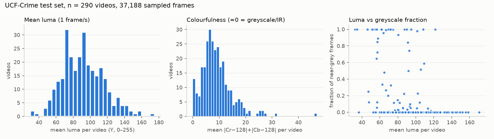

# EXP-000 — UCF-Crime data acquisition: results

Date: 2026-11-03. **Download status: PARTIAL.** The test set is COMPLETE and verified. Training videos are still
downloading in the background. The live status is the `STATUS:` line in `/Users/atruong/thesis-data/ucf-crime/README.md`,
which updates itself when the download finishes.

These are data and verification results, so there are no MLflow runs. Every number below comes from a file
(sha256 in `log.md`):

- `index_test.csv` (`c9ab617f…2e57`)
- `lighting_test.csv` (`1dae21c0…70a8`)
- the published gt files in `reference/`

All files are under `/Users/atruong/thesis-data/ucf-crime/`.

## Results

### Acquisition
| Item | Status |
|---|---|
| Temporal annotations (txt + mat, 290 videos) | downloaded, official, sha256 logged |
| Split files `Anomaly_Test.txt` (290) / `Anomaly_Train.txt` (1,610) | extracted from the official zip; all entries exist in the archive |
| 290 test videos (7.99 GB) | **290/290 CRC32 + size verified** against the official zip's central directory; 15.5 min |
| 1,660 other videos (1,610 train + 50 `z_Normal_Videos_event`, 96.9 GB) | in progress, ~6 MB/s, ETA ~4–5 h; resumable |

### Test-set verification (gates from plan.md)
| Gate | Expected | Observed |
|---|---|---|
| Test list | 290; 150 normal / 140 anomalous | 290; 150 / 140 ✔ |
| Annotation file names = test list | yes | yes ✔ (the 290 `.mat` files agree with the txt) |
| Violence-like subset | 38 | 38 ✔ (Abuse 2, Assault 3, Fighting 5, Robbery 5, Shooting 23) |
| Decodable | 290/290 | 290/290 ✔ (`ffprobe -count_frames`; decoded = container frame count for every video) |
| fps / resolution | ≈30 | all exactly 30/1 fps, 320×240, H.264 ✔ |
| Total frames | ≈1.11 M | **1,111,808** frames, 10.30 h ✔ |
| Anomalous frames | — | 84,331 (7.59 %) end-inclusive; 84,182 end-exclusive |
| Intervals within frame counts | all | all start inside. **7 intervals end at or past the last decoded frame** (Arson011 1267/1266, Arson016 1796/1795, Assault006 8096/8096, Explosion033 3156/3154, Fighting003 3103/3102, Shooting015 1715/1713, Shooting046 5088/5088); clipped |
| Train list | 1,610, all in the archive | 1,610 ✔, disjoint from the test list ✔ |

### Published ground-truth cross-check
| Reference | Length | Positives | Our reconstruction |
|---|---|---|---|
| VadCLIP `gt_ucf.npy` @c41067f | 1,109,888 | 84,160 | **identical for all 290 videos**. Rule: floor(n/16)·16 frames per video, end exclusive, order "anomalous videos (Anomaly_Test order) then normal videos". Shooting032 has 1 extra clip, and 48 extra zero frames among normals cannot be placed (all-zero, harmless). |
| RTFM `gt-ucf.npy` @cf938f4 | 1,114,144 | 84,389 | same length (ceil(n/16)·16) and identical except **46 frames in 4 videos** (Arson011, Arson016, Explosion033, Shooting015). In each one the annotation end overruns the decoded video, and RTFM labels up to its padded clip end. |

So our labels reproduce both published protocols. The KB figure of 1,109,888 frames is VadCLIP's *truncated* length.
The true decoded total is 1,111,808.

### Lighting (descriptive, 37,188 frames sampled at 1/s)

- `mean_luma` per video: median 90.3, IQR 74.0–108.3, range 32.5–170.7.
  - Counts below a few luma levels: < 50: 6 videos; < 60: 22; < 70: 49; < 80: 103. (Descriptive only; no threshold
    has been chosen.)
- Near-greyscale (`greyscale_frac` > 0.5): **32 videos**, 24 of them > 0.9. 222 videos have no greyscale frames.
  - By class: 26 of the 32 are **anomalous**, only 6 are normal.
- Violence-like subset (38): median mean_luma 85.1; 9 with mean_luma < 70; 4 mostly greyscale.

## Observations (eye-check of 12 frames: 4 darkest, 4 most greyscale, 4 mixed)
1. Mean luma alone misses IR footage. Several greyscale videos are clearly **IR night footage with high luma**, e.g.
   Burglary079 (mean_luma 121.7, greyscale 1.0, timestamp 05:07), Normal_Videos_925 (94.9, 1.0) and
   Vandalism028 (89.8, 1.0). IR illuminators make night scenes bright and grey. This is why the owner's labels need
   the `ir` class.
2. Low luma is not always IR. Burglary033 (36.4, the 3rd darkest) is a colour doorbell camera at night, and
   Normal_Videos_189 (47.7) is a colour night street scene. Both are `night`, not `ir`.
3. **Black borders and letterboxing are widespread.** Pixel p10 = 0 in 192/290 videos. Borders and burned-in
   timestamps bias mean luma downward and make p10 almost useless. For example, Arson018's p50 is 5 because of large
   black bars.
4. Some greyscale videos look like greyscale *indoor* scenes (e.g. Normal_Videos_175, chroma 2.6, timestamp 07:09).
   Whether these are IR or a grey day camera needs the owner's eye. That is the `unclear` / "grey daytime" rule in
   labelling.md.

## Threats to validity
- **Lighting is confounded with class.** IR/greyscale footage is concentrated in anomalous videos (26 vs 6 normal).
  - Inside an "IR" stratum, frame-AUC has few normal videos, so CIs will be wide.
  - A detector could also learn "greyscale ⇒ anomalous" as a shortcut.
  - Per-stratum AUC must be reported with per-class video counts.
- The border bias (observation 3) means the eventual luma rule should probably use an **active-area** mean (exclude
  constant black borders). This is a methodological choice to pre-register in the next step, not now.
- The greyscale cut-off (chroma < 3.0) is a heuristic fixed before looking at the data. Compression can leave small
  chroma noise in IR footage, so `mean_chroma` is also saved for re-analysis.
- 1 frame/s sampling can miss short lighting changes, e.g. lights switching on. `frame_mean_luma_min/max` partly
  exposes this.
- The label convention (inclusive vs exclusive, 0- vs 1-based) shifts at most 1 frame per interval: 149 frames out of
  1.1 M. This is negligible for AUC, but it is documented. Two annotation ends equal the frame count (Assault006,
  Shooting046), which hints that the authors counted from 1. We follow RTFM's 0-based reading because the published
  numbers were computed that way.
- The whole-file sha256 of `UCF_Crimes.zip` was not computed (member-wise extraction). The archive version is pinned
  by ETag + size, and each video by CRC32 + its own sha256.

## Next steps
1. Owner: fill in `labelling_sheet.csv` (instructions in `labelling.md`, ~2–3 h).
2. Pre-register the luma/greyscale stratum rule. Proposal: active-area mean luma + greyscale_frac, threshold fixed on
   a random half of the owner labels and evaluated on the other half. Report confusion matrix + κ.
3. When the README shows COMPLETE: verify train counts (automatic), then run ffprobe over the train set if Phase 0
   needs it.
4. Fix the KB note `kb/datasets/ucf-crime.md` (1,109,888 is VadCLIP's truncated length; the decoded total is
   1,111,808). That edit is outside this lane, so it is left for the lead.

## Owner sign-off
- [ ] Owner reviewed acquisition, verification and the label convention: _pending_
