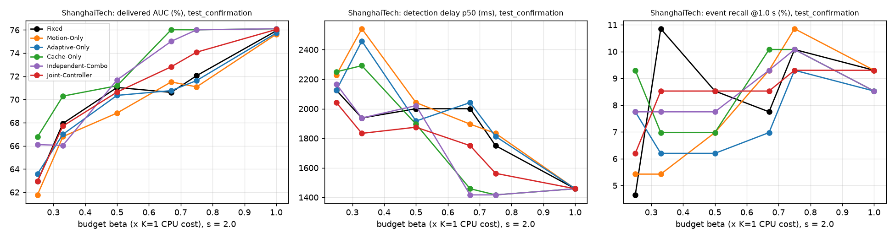
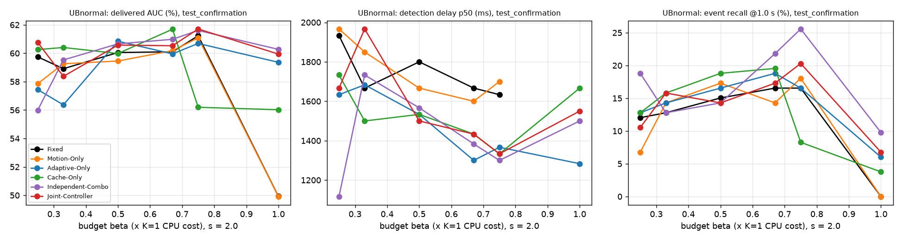

# Q2-P1-E03 — Core ablation: report

**Hardware / honesty disclosure.** The physical Raspberry Pi 5 is **not connected**. Every service time is sampled from the E02 VM pools (`edge-os-arm64-vm`, a comparative proxy) and scaled by a Pi multiplier `s`; all E03 numbers are *simulated delivery on replayed detections* (frozen frontend `ML0_ncnn`@640 for ShanghaiTech, `ML0_mps` proxy for UBnormal, locked BoT-SORT tracker, frozen STG-NF scorer, E00 causal S3/S4 protocol), not Pi measurements. No training was done. All thresholds come from `test_dev` or the E00 train sentinels; **verdicts use `test_confirmation` of ShanghaiTech (72 videos)**, UBnormal (141 confirmation videos) is the replication.

## 1. Answer in one paragraph

At matched total CPU cost (12-cell average, SHT `test_confirmation`, delivered AUC): **cross-frame detector reuse (C1) is the only mechanism that clearly pays** (Cache-Only − Fixed +2.41 [+1.39, +3.48] pt, net CPU saving 29 %), while **event-aware scheduling does not beat a fixed burst schedule** (Adaptive − Fixed -0.17 [-0.99, +0.65] pt; Motion-Only is worse than Fixed, -1.35 [-2.55, -0.26]), and **the joint controller loses after overhead** (Joint − Cache-Only -1.60 [-2.43, -0.82], Joint − Independent -1.20 [-2.06, -0.34]). Scorer reuse (C2) saves only 0.3 % CPU on average (scoring is ~4 % of the K=1 CPU and C2 hits <= 18 % of the candidate windows) and is dropped. Verdicts — **H1: partially supported**, **H2: supported**, **H3: not supported**; stop rule: Joint-Controller **rejected**; **lock for E04/E05: `Cache-C1 (C1 only; C2 dropped)`**. UBnormal replicates only part of this (H1 partially supported, H2 not supported, H3 not supported; best arm there: `Independent-Combo`), because most of its cells are overload cells in which only backlog-aware arms survive (section 7).

## 2. Setup actually used

Selected on the `test_dev` stream (3 tuning cells (2.0,0.33), (2.0,0.75), (3.0,1.00); ties within 0.10 pt -> simpler); everything else fixed a priori in `config.yaml`:

| dataset | arm | selected hyper-parameters |
|---|---|---|
| ShanghaiTech | Motion-Only | theta=q85\|extend=True\|p=1 |
| ShanghaiTech | Adaptive-Only | tau0=0.8\|extend=False\|p=1 |
| ShanghaiTech | Cache-C1 | l1=3\|l2=0 |
| ShanghaiTech | Cache-C2 | l1=0\|l2=2 |
| ShanghaiTech | Cache-Only | l1=3\|l2=2 |
| ShanghaiTech | Independent-Combo | tau0=0.8\|extend=False\|p=1\|l1=3\|l2=2 |
| ShanghaiTech | Joint-Controller | tau0=1.4\|extend=False\|p=1\|l1=3\|l2=2 |
| ShanghaiTech | Fixed | (none) |
| UBnormal | Motion-Only | theta=q70\|extend=False\|p=1 |
| UBnormal | Adaptive-Only | tau0=0.8\|extend=False\|p=2 |
| UBnormal | Cache-C1 | l1=3\|l2=0 |
| UBnormal | Cache-C2 | l1=0\|l2=1 |
| UBnormal | Cache-Only | l1=3\|l2=1 |
| UBnormal | Independent-Combo | tau0=0.8\|extend=False\|p=2\|l1=3\|l2=1 |
| UBnormal | Joint-Controller | tau0=0.8\|extend=False\|p=2\|l1=3\|l2=1 |
| UBnormal | Fixed | (none) |

Cells: `s = 2.0` with `beta in {0.25, 0.33, 0.50, 0.67, 0.75, 1.00}`; overload cells `s in {2.5, 3.0}` with `beta in {0.50, 0.75, 1.00}`. Target = `beta x C_full(s)` (`C_full` = CPU of the K=1 pipeline on the same stream; SHT 2276 CPU-ms/s at s=2). Each arm's rate knob is bisected label-free until the realised CPU (incl. observer / C1-check / C2-check) is within [0.97, 1.0] of the target (flag `under` = cannot spend the budget: full coverage already reached, `over` = cannot get below it).

## 3. Correctness rules (pre-registered, `summary.json -> rules`)

| rule | statement | SHT | UB |
|---|---|---|---|
| E3-D1 | F(W > L) at zero delay vs E02 burst{W} (all / dev / confirmation), tolerance 0.02 pt | PASS | PASS |
| E3-D2 | continuous run tables (tracker re-created every Delta frames) vs E02 K=1 persistent tracker, zero delay; pass if \|all\| <= 0.5 pt | PASS | PASS |
| E3-D3 | rows of frames the policy did not request are set to NaN: decisions, costs and delivered values unchanged; feedback is popped only for jobs with finish <= job start (simulate()) | PASS | PASS |
| E3-D4 | E02 queue invariants on a full stream of every headline family at (2.0, 0.50) | PASS | PASS |
| E3-D5 | zero-service landing == ideal series; simulating only the first half of the clips leaves every earlier clip's delivered series unchanged | PASS | PASS |
| E3-D6 | realised cost / target in [0.97, 1.005] after calibration, or the cell is flagged under / over-spending | PASS | PASS |
| E3-D7 | C1 never reuses a detector output older than A1, C2 never a score older than A2 (state is reset at every clip / run start; the elevated-anomaly source test is the nu_safe condition, unit-tested) | PASS | PASS |

E3-D1 max |AUC difference| to E02 burst baselines = 0.0000 pt (exact replay). E3-D2: continuous run tables (tracker re-created every Delta frames) differ from E02's persistent K=1 tracker by -0.45 pt (all clips; dev -0.97, confirmation -0.17) at 2276 vs 2278 CPU-ms/s — a small, **common** handicap of every continuous-run arm.

## 4a. Matched-cost accuracy / delay curves — ShanghaiTech

**Delivered AUC (%), `confirmation`** (pooled over videos; `*` = arm under-spends its budget, `!` = unsustainable queue: late work discarded)

| cell | Fixed | Motion-Only | Adaptive-Only | Cache-Only | Independent-Combo | Joint-Controller |
|---|---|---|---|---|---|---|
| s2.0_b0.25 | 62.93 | 61.77 | 63.57 | 66.77 | 66.11 | 62.95 |
| s2.0_b0.33 | 67.93 | 66.80 | 67.00 | 70.29 | 66.04 | 67.71 |
| s2.0_b0.50 | 71.04 | 68.83 | 70.36 | 71.18 | 71.69 | 70.64 |
| s2.0_b0.67 | 70.61 | 71.51 | 70.77 | 76.02 | 75.01 | 72.82 |
| s2.0_b0.75 | 72.06 | 71.09 | 71.63 | 76.01* | 76.01* | 74.08 |
| s2.0_b1.00 | 75.92 | 75.63 | 75.73 | 76.10* | 76.10* | 76.04* |
| s2.5_b0.50 | 71.04 | 68.81 | 70.62 | 71.17 | 71.36 | 69.87 |
| s2.5_b0.75 | 72.03 | 71.22 | 71.42 | 75.98* | 75.99* | 74.27 |
| s2.5_b1.00 | 75.75 | 75.45 | 75.21 | 75.86* | 75.89* | 75.80* |
| s3.0_b0.50 | 70.90 | 69.09 | 69.98 | 71.09 | 72.97 | 69.66 |
| s3.0_b0.75 | 71.96 | 71.18 | 70.71 | 75.71* | 75.64* | 74.23 |
| s3.0_b1.00 | 70.56! | 65.13! | 73.65 | 75.25* | 73.88* | 74.21* |
| **mean of 12** | **71.06** | **69.71** | **70.89** | **73.45** | **73.06** | **71.86** |

**Delivered AUC (%), `dev`** (pooled over videos; `*` = arm under-spends its budget, `!` = unsustainable queue: late work discarded)

| cell | Fixed | Motion-Only | Adaptive-Only | Cache-Only | Independent-Combo | Joint-Controller |
|---|---|---|---|---|---|---|
| s2.0_b0.25 | 67.47 | 69.39 | 69.32 | 66.11 | 67.50 | 70.94 |
| s2.0_b0.33 | 63.17 | 67.57 | 64.00 | 67.53 | 67.75 | 65.84 |
| s2.0_b0.50 | 69.38 | 67.67 | 71.58 | 71.47 | 70.78 | 68.60 |
| s2.0_b0.67 | 70.56 | 70.36 | 72.85 | 75.13 | 75.74 | 72.37 |
| s2.0_b0.75 | 72.88 | 72.50 | 71.36 | 75.28* | 75.27* | 73.48 |
| s2.0_b1.00 | 76.29 | 77.28 | 76.59 | 76.39* | 76.40* | 76.34* |
| s2.5_b0.50 | 69.38 | 68.28 | 71.60 | 71.46 | 68.42 | 68.72 |
| s2.5_b0.75 | 72.86 | 72.39 | 71.09 | 75.27* | 75.28* | 73.25 |
| s2.5_b1.00 | 76.08 | 77.12 | 75.78 | 76.27* | 76.31* | 76.11* |
| s3.0_b0.50 | 69.41 | 68.48 | 71.01 | 71.35 | 71.42 | 68.33 |
| s3.0_b0.75 | 72.86 | 72.18 | 71.42 | 75.09* | 74.94* | 73.48 |
| s3.0_b1.00 | 60.80! | 54.10! | 72.77 | 76.53* | 74.83* | 74.30* |
| **mean of 12** | **70.10** | **69.78** | **71.61** | **73.16** | **72.89** | **71.81** |

**Ideal AUC (%), `confirmation`** (same decisions, zero service delay)

| cell | Fixed | Motion-Only | Adaptive-Only | Cache-Only | Independent-Combo | Joint-Controller |
|---|---|---|---|---|---|---|
| s2.0_b0.25 | 63.09 | 61.89 | 63.74 | 66.93 | 66.28 | 63.11 |
| s2.0_b0.33 | 68.15 | 66.99 | 67.20 | 70.54 | 66.21 | 67.95 |
| s2.0_b0.50 | 71.27 | 69.03 | 70.60 | 71.41 | 71.95 | 70.84 |
| s2.0_b0.67 | 70.82 | 71.74 | 70.95 | 76.30 | 75.26 | 73.01 |
| s2.0_b0.75 | 72.30 | 71.31 | 71.88 | 76.30 | 76.30 | 74.32 |
| s2.0_b1.00 | 76.17 | 75.90 | 76.00 | 76.33 | 76.34 | 76.28 |
| s2.5_b0.50 | 71.27 | 69.03 | 70.87 | 71.41 | 71.60 | 70.05 |
| s2.5_b0.75 | 72.30 | 71.47 | 71.64 | 76.30 | 76.30 | 74.48 |
| s2.5_b1.00 | 76.17 | 75.90 | 75.61 | 76.33 | 76.34 | 76.28 |
| s3.0_b0.50 | 71.27 | 69.39 | 70.38 | 71.41 | 73.45 | 70.03 |
| s3.0_b0.75 | 72.30 | 71.35 | 71.13 | 76.30 | 76.30 | 74.59 |
| s3.0_b1.00 | 76.17 | 75.90 | 74.70 | 76.33 | 75.27 | 74.90 |

**Event metrics, `confirmation`** (alert = delayed score above the locked dev threshold for >= 6 frames; recall = fraction of events detected within 0.5 / 1.0 s; delay p50 / p90 over detected events; FA/h per hour of normal video; 129 events)

| cell | arm | recall@0.5s % | recall@1.0s % | missed % | delay p50 ms | delay p90 ms | FA/h | CPU ms/s | cost/target | queue mean ms | p99 latency ms | max wait ms | peak mem MB |
|---|---|---|---|---|---|---|---|---|---|---|---|---|---|
| s2.0_b0.33 | Fixed | 10.1 | 10.9 | 62.8 | 1938 | 4008 | 11 | 742 | 0.987 | 0 | 32 | 27 | 898 |
| s2.0_b0.33 | Motion-Only | 4.7 | 5.4 | 69.0 | 2542 | 4467 | 16 | 753 | 0.998 | 0 | 33 | 28 | 898 |
| s2.0_b0.33 | Adaptive-Only | 6.2 | 6.2 | 63.6 | 2458 | 4675 | 11 | 751 | 0.998 | 0 | 33 | 30 | 898 |
| s2.0_b0.33 | Cache-Only | 6.2 | 7.0 | 57.4 | 2292 | 4908 | 0 | 740 | 0.997 | 0 | 33 | 27 | 898 |
| s2.0_b0.33 | Independent-Combo | 5.4 | 7.8 | 62.8 | 1938 | 4258 | 5 | 736 | 0.993 | 0 | 34 | 30 | 898 |
| s2.0_b0.33 | Joint-Controller | 7.0 | 8.5 | 65.1 | 1833 | 5983 | 11 | 744 | 0.997 | 0 | 34 | 30 | 898 |
| s2.0_b0.50 | Fixed | 8.5 | 8.5 | 52.7 | 2000 | 4417 | 16 | 1135 | 0.998 | 0 | 36 | 27 | 898 |
| s2.0_b0.50 | Motion-Only | 5.4 | 7.0 | 57.4 | 2042 | 4358 | 11 | 1133 | 0.996 | 0 | 37 | 33 | 899 |
| s2.0_b0.50 | Adaptive-Only | 6.2 | 6.2 | 58.9 | 1917 | 4483 | 11 | 1131 | 0.996 | 0 | 36 | 33 | 899 |
| s2.0_b0.50 | Cache-Only | 7.0 | 7.0 | 53.5 | 1896 | 5958 | 37 | 1126 | 0.997 | 0 | 36 | 29 | 898 |
| s2.0_b0.50 | Independent-Combo | 6.2 | 7.8 | 56.6 | 2021 | 5938 | 5 | 1122 | 0.998 | 0 | 39 | 34 | 899 |
| s2.0_b0.50 | Joint-Controller | 7.0 | 8.5 | 57.4 | 1875 | 5292 | 11 | 1129 | 0.996 | 0 | 38 | 34 | 899 |
| s2.0_b0.75 | Fixed | 9.3 | 10.1 | 53.5 | 1750 | 3704 | 21 | 1703 | 0.999 | 0 | 41 | 32 | 898 |
| s2.0_b0.75 | Motion-Only | 9.3 | 10.9 | 47.3 | 1833 | 4917 | 21 | 1705 | 0.998 | 0 | 42 | 33 | 899 |
| s2.0_b0.75 | Adaptive-Only | 8.5 | 9.3 | 53.5 | 1812 | 4133 | 37 | 1707 | 0.997 | 0 | 42 | 29 | 898 |
| s2.0_b0.75 | Cache-Only | 6.2 | 10.1 | 46.5 | 1417 | 5458 | 37 | 1616 | 0.961 | 0 | 43 | 43 | 899 |
| s2.0_b0.75 | Independent-Combo | 6.2 | 10.1 | 46.5 | 1417 | 5458 | 37 | 1628 | 0.968 | 0 | 44 | 43 | 899 |
| s2.0_b0.75 | Joint-Controller | 7.0 | 9.3 | 47.3 | 1562 | 4483 | 32 | 1695 | 0.999 | 0 | 44 | 34 | 899 |
| s3.0_b1.00 | Fixed | 5.4 | 7.8 | 53.5 | 1562 | 5892 | 26 | 3403 | 1.000 | 409 | 2635 | 2800 | 977 |
| s3.0_b1.00 | Motion-Only | 6.2 | 7.0 | 58.1 | 1667 | 5500 | 21 | 3396 | 0.995 | 899 | 5300 | 5440 | 1051 |
| s3.0_b1.00 | Adaptive-Only | 5.4 | 8.5 | 52.7 | 1667 | 5500 | 21 | 3359 | 0.986 | 113 | 287 | 317 | 907 |
| s3.0_b1.00 | Cache-Only | 5.4 | 8.5 | 51.2 | 1542 | 5225 | 26 | 2425 | 0.721 | 43 | 819 | 1313 | 935 |
| s3.0_b1.00 | Independent-Combo | 5.4 | 8.5 | 51.9 | 1583 | 5346 | 26 | 2424 | 0.719 | 35 | 281 | 287 | 906 |
| s3.0_b1.00 | Joint-Controller | 6.2 | 9.3 | 51.9 | 1521 | 5292 | 21 | 2877 | 0.852 | 71 | 294 | 314 | 906 |

## 4b. Matched-cost accuracy / delay curves — UBnormal

**Delivered AUC (%), `confirmation`** (pooled over videos; `*` = arm under-spends its budget, `!` = unsustainable queue: late work discarded)

| cell | Fixed | Motion-Only | Adaptive-Only | Cache-Only | Independent-Combo | Joint-Controller |
|---|---|---|---|---|---|---|
| s2.0_b0.25 | 59.74* | 57.86 | 57.44 | 60.26 | 55.99 | 60.76 |
| s2.0_b0.33 | 58.91 | 59.26 | 56.37 | 60.40* | 59.53 | 58.37 |
| s2.0_b0.50 | 60.05 | 59.45 | 60.85 | 59.98 | 60.66 | 60.57 |
| s2.0_b0.67 | 60.10 | 60.18 | 59.95 | 61.69* | 60.98 | 60.53 |
| s2.0_b0.75 | 61.23* | 61.08 | 60.69 | 56.20! | 61.60* | 61.71 |
| s2.0_b1.00 | 49.92! | 49.91! | 59.36* | 56.02*! | 60.27* | 59.94* |
| s2.5_b0.50 | 60.01 | 59.40 | 58.89 | 59.96 | 58.32 | 58.96 |
| s2.5_b0.75 | 49.91*! | 49.88! | 59.43* | 51.62! | 60.12* | 59.97* |
| s2.5_b1.00 | 50.01! | 50.00! | 57.67* | 49.98*! | 58.60* | 57.93* |
| s3.0_b0.50 | 60.04 | 59.11 | 50.22 | 56.01! | 56.25 | 54.96 |
| s3.0_b0.75 | 49.94*! | 49.94! | 51.44* | 49.99! | 56.26* | 53.44* |
| s3.0_b1.00 | 49.98! | 49.98! | 51.07* | 49.97*! | 56.04* | 53.24* |
| **mean of 12** | **55.82** | **55.50** | **56.95** | **56.01** | **58.72** | **58.37** |

**Delivered AUC (%), `dev`** (pooled over videos; `*` = arm under-spends its budget, `!` = unsustainable queue: late work discarded)

| cell | Fixed | Motion-Only | Adaptive-Only | Cache-Only | Independent-Combo | Joint-Controller |
|---|---|---|---|---|---|---|
| s2.0_b0.25 | 51.91* | 52.66 | 49.67 | 54.79 | 50.10 | 49.18 |
| s2.0_b0.33 | 53.75 | 54.97 | 52.08 | 54.20* | 52.57 | 52.86 |
| s2.0_b0.50 | 53.98 | 55.36 | 55.35 | 56.15 | 54.25 | 54.11 |
| s2.0_b0.67 | 56.11 | 56.86 | 56.59 | 56.83* | 55.88 | 56.76 |
| s2.0_b0.75 | 55.65* | 56.52 | 56.12 | 57.64! | 56.73* | 56.43 |
| s2.0_b1.00 | 50.20! | 50.18! | 55.64* | 58.04*! | 57.67* | 57.00* |
| s2.5_b0.50 | 53.60 | 54.59 | 51.50 | 55.65 | 51.61 | 55.08 |
| s2.5_b0.75 | 49.92*! | 50.16! | 53.86* | 53.03! | 55.00* | 55.40* |
| s2.5_b1.00 | 50.00! | 50.00! | 53.26* | 50.07*! | 55.20* | 55.20* |
| s3.0_b0.50 | 53.04 | 54.30 | 49.69 | 57.71! | 55.32 | 54.73 |
| s3.0_b0.75 | 50.00*! | 50.00! | 49.59* | 50.21! | 55.42* | 56.50* |
| s3.0_b1.00 | 50.00! | 50.00! | 49.70* | 50.32*! | 54.65* | 54.48* |
| **mean of 12** | **52.35** | **52.97** | **52.76** | **54.55** | **54.53** | **54.81** |

**Ideal AUC (%), `confirmation`** (same decisions, zero service delay)

| cell | Fixed | Motion-Only | Adaptive-Only | Cache-Only | Independent-Combo | Joint-Controller |
|---|---|---|---|---|---|---|
| s2.0_b0.25 | 59.74 | 58.03 | 57.22 | 60.44 | 55.95 | 60.75 |
| s2.0_b0.33 | 59.04 | 59.43 | 56.37 | 60.60 | 59.50 | 58.22 |
| s2.0_b0.50 | 60.09 | 59.57 | 60.55 | 60.09 | 60.72 | 60.24 |
| s2.0_b0.67 | 60.36 | 60.33 | 59.97 | 61.82 | 61.14 | 60.41 |
| s2.0_b0.75 | 61.52 | 61.35 | 60.69 | 62.60 | 61.81 | 61.79 |
| s2.0_b1.00 | 61.77 | 61.79 | 58.82 | 61.73 | 60.16 | 59.21 |
| s2.5_b0.50 | 60.09 | 59.74 | 59.08 | 60.09 | 58.30 | 58.52 |
| s2.5_b0.75 | 61.52 | 61.12 | 59.63 | 62.60 | 59.95 | 59.60 |
| s2.5_b1.00 | 61.77 | 61.79 | 57.53 | 61.73 | 58.20 | 57.26 |
| s3.0_b0.50 | 60.09 | 59.40 | 50.21 | 60.09 | 56.32 | 54.56 |
| s3.0_b0.75 | 61.52 | 61.16 | 51.58 | 62.60 | 56.34 | 52.91 |
| s3.0_b1.00 | 61.77 | 61.79 | 51.14 | 61.73 | 56.04 | 52.78 |

**Event metrics, `confirmation`** (alert = delayed score above the locked dev threshold for >= 6 frames; recall = fraction of events detected within 0.5 / 1.0 s; delay p50 / p90 over detected events; FA/h per hour of normal video; 133 events)

| cell | arm | recall@0.5s % | recall@1.0s % | missed % | delay p50 ms | delay p90 ms | FA/h | CPU ms/s | cost/target | queue mean ms | p99 latency ms | max wait ms | peak mem MB |
|---|---|---|---|---|---|---|---|---|---|---|---|---|---|
| s2.0_b0.33 | Fixed | 8.3 | 12.8 | 60.2 | 1667 | 7927 | 56 | 1340 | 1.000 | 14 | 196 | 383 | 955 |
| s2.0_b0.33 | Motion-Only | 8.3 | 14.3 | 57.9 | 1850 | 9450 | 90 | 1338 | 0.998 | 15 | 201 | 497 | 964 |
| s2.0_b0.33 | Adaptive-Only | 10.5 | 14.3 | 53.4 | 1683 | 8043 | 49 | 1335 | 0.998 | 18 | 229 | 489 | 963 |
| s2.0_b0.33 | Cache-Only | 9.0 | 15.8 | 52.6 | 1500 | 7213 | 79 | 1288 | 0.963 | 11 | 188 | 400 | 956 |
| s2.0_b0.33 | Independent-Combo | 7.5 | 12.8 | 51.1 | 1733 | 7627 | 90 | 1341 | 1.000 | 13 | 200 | 447 | 960 |
| s2.0_b0.33 | Joint-Controller | 10.5 | 15.8 | 51.9 | 1967 | 9563 | 67 | 1331 | 0.996 | 16 | 221 | 479 | 963 |
| s2.0_b0.50 | Fixed | 9.0 | 15.0 | 49.6 | 1800 | 7447 | 109 | 1968 | 0.970 | 21 | 215 | 451 | 960 |
| s2.0_b0.50 | Motion-Only | 7.5 | 17.3 | 40.6 | 1667 | 8807 | 146 | 2026 | 0.997 | 24 | 223 | 443 | 960 |
| s2.0_b0.50 | Adaptive-Only | 9.0 | 16.5 | 53.4 | 1533 | 8600 | 116 | 2027 | 0.998 | 33 | 265 | 492 | 964 |
| s2.0_b0.50 | Cache-Only | 12.0 | 18.8 | 42.9 | 1533 | 7283 | 135 | 2028 | 0.998 | 20 | 217 | 429 | 959 |
| s2.0_b0.50 | Independent-Combo | 9.0 | 14.3 | 43.6 | 1567 | 7880 | 127 | 2028 | 0.998 | 25 | 245 | 463 | 961 |
| s2.0_b0.50 | Joint-Controller | 7.5 | 14.3 | 46.6 | 1500 | 8300 | 131 | 2028 | 0.998 | 31 | 269 | 550 | 968 |
| s2.0_b0.75 | Fixed | 8.3 | 16.5 | 42.1 | 1633 | 7433 | 150 | 2948 | 0.968 | 44 | 299 | 550 | 968 |
| s2.0_b0.75 | Motion-Only | 9.8 | 18.0 | 39.1 | 1700 | 8300 | 120 | 3046 | 0.998 | 75 | 466 | 806 | 988 |
| s2.0_b0.75 | Adaptive-Only | 10.5 | 16.5 | 43.6 | 1367 | 7087 | 154 | 3043 | 0.998 | 90 | 375 | 524 | 966 |
| s2.0_b0.75 | Cache-Only | 5.3 | 8.3 | 79.7 | 1333 | 8000 | 37 | 3046 | 0.998 | 14902 | 53543 | 55297 | 5299 |
| s2.0_b0.75 | Independent-Combo | 14.3 | 25.6 | 36.1 | 1300 | 7880 | 150 | 2844 | 0.933 | 147 | 435 | 568 | 970 |
| s2.0_b0.75 | Joint-Controller | 11.3 | 20.3 | 40.6 | 1333 | 8360 | 176 | 3040 | 0.999 | 190 | 440 | 582 | 971 |
| s3.0_b1.00 | Fixed | 0.0 | 0.0 | 100.0 | n/a | n/a | 0 | 6099 | 1.000 | 1262560 | 2472330 | 2496986 | 198440 |
| s3.0_b1.00 | Motion-Only | 0.0 | 0.0 | 100.0 | n/a | n/a | 0 | 6078 | 0.997 | 1291287 | 2527233 | 2552504 | 202832 |
| s3.0_b1.00 | Adaptive-Only | 0.0 | 0.0 | 98.5 | 6833 | 11420 | 0 | 3177 | 0.522 | 266 | 498 | 736 | 983 |
| s3.0_b1.00 | Cache-Only | 0.0 | 0.0 | 100.0 | n/a | n/a | 0 | 4932 | 0.808 | 711471 | 1507650 | 1515439 | 120798 |
| s3.0_b1.00 | Independent-Combo | 0.8 | 1.5 | 91.0 | 1917 | 8417 | 11 | 3062 | 0.503 | 211 | 481 | 864 | 993 |
| s3.0_b1.00 | Joint-Controller | 0.0 | 0.0 | 95.5 | 3967 | 12700 | 4 | 3087 | 0.507 | 229 | 491 | 843 | 991 |

## 5. Hypotheses (12-cell average of paired video-bootstrap contrasts, delivered AUC in pt; verdicts on SHT `test_confirmation`)

**ShanghaiTech** — contrasts A − B (`dev` | `confirmation` | `all`; delta [95 % CI]):

| contrast | dev | confirmation | all |
|---|---|---|---|
| H1.Adaptive-Fixed | +1.43 [-0.33, +3.16] | -0.17 [-0.99, +0.65] | +0.43 [-0.40, +1.28] |
| H1.Adaptive-Motion | +1.83 [+0.31, +3.23] | +1.17 [+0.14, +2.33] | +1.48 [+0.62, +2.42] |
| H2.Cache-Fixed | +2.99 [+1.38, +4.59] | +2.41 [+1.39, +3.48] | +2.62 [+1.71, +3.50] |
| H2.C1-Fixed | +2.95 [+1.36, +4.54] | +2.39 [+1.39, +3.46] | +2.59 [+1.70, +3.47] |
| H2.C2-Fixed | +1.15 [+0.26, +2.13] | +0.32 [+0.03, +0.73] | +0.64 [+0.23, +1.14] |
| H3.Joint-Adaptive | +0.21 [-1.06, +1.42] | +0.99 [+0.04, +1.94] | +0.71 [-0.06, +1.46] |
| H3.Joint-Cache | -1.35 [-2.41, -0.30] | -1.60 [-2.43, -0.82] | -1.48 [-2.12, -0.88] |
| H3.Joint-Independent | -1.08 [-1.98, -0.13] | -1.20 [-2.06, -0.34] | -1.16 [-1.79, -0.55] |
| H3.Joint-Fixed | +1.64 [-0.28, +3.43] | +0.82 [-0.34, +2.00] | +1.14 [+0.15, +2.11] |
| X.Joint-Motion | +2.04 [+0.42, +3.71] | +2.16 [+0.82, +3.58] | +2.19 [+1.13, +3.34] |
| X.Motion-Fixed | -0.40 [-2.32, +1.53] | -1.35 [-2.55, -0.26] | -1.06 [-2.11, -0.10] |
| X.Independent-Fixed | +2.72 [+0.85, +4.64] | +2.02 [+0.97, +3.18] | +2.30 [+1.30, +3.30] |
| X.Independent-Adaptive | +1.29 [+0.09, +2.49] | +2.19 [+1.12, +3.30] | +1.87 [+1.03, +2.78] |
| X.Independent-Cache | -0.27 [-1.13, +0.67] | -0.40 [-0.97, +0.21] | -0.32 [-0.82, +0.18] |
| X.Adaptive-Cache | -1.56 [-2.93, -0.25] | -2.59 [-3.45, -1.64] | -2.19 [-2.96, -1.43] |
| X.Motion-Cache | -3.39 [-4.75, -2.15] | -3.76 [-5.17, -2.53] | -3.67 [-4.81, -2.69] |

Sensitivity — only the 11 cells in which Fixed's queue is sustainable (s2.0_b0.25, s2.0_b0.33, s2.0_b0.50, s2.0_b0.67, s2.0_b0.75, s2.0_b1.00, s2.5_b0.50, s2.5_b0.75, s2.5_b1.00, s3.0_b0.50, s3.0_b0.75) and the budget cells beta < 1 are in `summary.json` (`contrasts_stable_cells`, `contrasts_budget_cells_only`).

Verdicts (ShanghaiTech, confirmation): **H1 partially supported**; **H2 supported** (net saving 29.2 %, recall@1.0 s Cache − Fixed -0.13 pt); C1: supported (saving 28.5 %, kept); C2: not supported (saving 0.3 %, dropped); **H3 not supported**.

**UBnormal** — contrasts A − B (`dev` | `confirmation` | `all`; delta [95 % CI]):

| contrast | dev | confirmation | all |
|---|---|---|---|
| H1.Adaptive-Fixed | +0.39 [-1.06, +1.87] | +1.12 [-0.01, +2.16] | +0.88 [-0.04, +1.78] |
| H1.Adaptive-Motion | -0.24 [-1.95, +1.40] | +1.44 [+0.27, +2.50] | +0.88 [-0.11, +1.88] |
| H2.Cache-Fixed | +2.25 [+0.49, +4.25] | +0.18 [-1.03, +1.48] | +0.84 [-0.19, +1.84] |
| H2.C1-Fixed | +2.21 [+0.44, +4.22] | +0.18 [-1.04, +1.47] | +0.82 [-0.20, +1.82] |
| H2.C2-Fixed | -0.00 [-0.01, +0.00] | +0.00 [-0.00, +0.00] | -0.00 [-0.00, +0.00] |
| H3.Joint-Adaptive | +2.01 [-0.31, +4.25] | +1.39 [-0.02, +2.84] | +1.62 [+0.44, +2.91] |
| H3.Joint-Cache | +0.15 [-3.06, +3.31] | +2.32 [+0.09, +4.41] | +1.67 [-0.08, +3.44] |
| H3.Joint-Independent | +0.27 [-0.96, +1.53] | -0.35 [-1.33, +0.63] | -0.15 [-0.92, +0.65] |
| H3.Joint-Fixed | +2.40 [-0.42, +5.18] | +2.51 [+0.69, +4.23] | +2.51 [+0.92, +4.03] |
| X.Joint-Motion | +1.77 [-1.28, +4.55] | +2.82 [+0.96, +4.68] | +2.50 [+0.91, +4.09] |
| X.Motion-Fixed | +0.64 [-0.27, +1.61] | -0.32 [-0.82, +0.19] | +0.00 [-0.45, +0.47] |
| X.Independent-Fixed | +2.13 [-1.17, +5.36] | +2.86 [+0.80, +4.83] | +2.66 [+0.84, +4.36] |
| X.Independent-Adaptive | +1.74 [-1.06, +4.44] | +1.74 [+0.11, +3.42] | +1.78 [+0.31, +3.30] |
| X.Independent-Cache | -0.12 [-3.71, +3.74] | +2.67 [+0.24, +5.03] | +1.82 [-0.19, +3.74] |
| X.Adaptive-Cache | -1.86 [-4.42, +0.95] | +0.94 [-0.89, +2.63] | +0.04 [-1.41, +1.59] |
| X.Motion-Cache | -1.62 [-3.55, +0.11] | -0.50 [-1.74, +0.65] | -0.84 [-1.81, +0.12] |

Sensitivity — only the 7 cells in which Fixed's queue is sustainable (s2.0_b0.25, s2.0_b0.33, s2.0_b0.50, s2.0_b0.67, s2.0_b0.75, s2.5_b0.50, s3.0_b0.50) and the budget cells beta < 1 are in `summary.json` (`contrasts_stable_cells`, `contrasts_budget_cells_only`).

Verdicts (UBnormal, confirmation): **H1 partially supported**; **H2 not supported** (net saving 20.0 %, recall@1.0 s Cache − Fixed +0.25 pt); C1: not supported (saving 19.9 %, kept); C2: not supported (saving 0.1 %, dropped); **H3 not supported**.

## 6. Cache mechanisms (C1 detector-output reuse, C2 scorer reuse)

**ShanghaiTech** pose error of reused poses (height-normalised mean / p90) by C1 level: L1: 0.029 / 0.055; L2: 0.039 / 0.075; L3: 0.045 / 0.085.

| cell | arm | net saving % | saved ms/s | overhead ms/s | C1 hit % | C1 refreshes | C1 src age (frames) | C2 hit % | C2 \|dNormality\| mean | C2 src age |
|---|---|---|---|---|---|---|---|---|---|---|
| s2.0_b0.33 | Cache-C1 | 31.1 | 342 | 4.0 | 32.9 | 13335 | 1.71 | 0.0 | 0.0000 | 0.00 |
| s2.0_b0.33 | Cache-C2 | -0.0 | 0 | 0.0 | 0.0 | 14124 | 0.00 | 0.0 | 0.0000 | 0.00 |
| s2.0_b0.33 | Cache-Only | 31.1 | 342 | 4.0 | 32.9 | 13335 | 1.71 | 0.0 | 0.0000 | 0.00 |
| s2.0_b0.33 | Independent-Combo | 29.3 | 312 | 3.8 | 33.1 | 11862 | 1.72 | 16.4 | 0.0116 | 1.15 |
| s2.0_b0.33 | Joint-Controller | 23.3 | 231 | 3.4 | 26.3 | 12323 | 1.88 | 14.6 | 0.0115 | 1.20 |
| s2.0_b0.67 | Cache-C1 | 28.5 | 614 | 7.2 | 32.8 | 23916 | 1.73 | 0.0 | 0.0000 | 0.00 |
| s2.0_b0.67 | Cache-C2 | -0.0 | 0 | 0.0 | 0.0 | 29194 | 0.00 | 0.0 | 0.0000 | 0.00 |
| s2.0_b0.67 | Cache-Only | 28.9 | 625 | 8.0 | 32.8 | 23916 | 1.73 | 9.4 | 0.0115 | 1.27 |
| s2.0_b0.67 | Independent-Combo | 27.9 | 595 | 7.8 | 32.4 | 22719 | 1.73 | 17.4 | 0.0112 | 1.16 |
| s2.0_b0.67 | Joint-Controller | 16.8 | 312 | 6.7 | 18.8 | 25349 | 1.84 | 13.8 | 0.0107 | 1.15 |
| s2.0_b1.00 | Cache-C1 | 26.7 | 614 | 7.2 | 32.8 | 23916 | 1.73 | 0.0 | 0.0000 | 0.00 |
| s2.0_b1.00 | Cache-C2 | 1.3 | 31 | 1.3 | 0.0 | 37294 | 0.00 | 17.7 | 0.0105 | 1.15 |
| s2.0_b1.00 | Cache-Only | 27.9 | 644 | 8.5 | 32.8 | 23916 | 1.73 | 17.7 | 0.0112 | 1.16 |
| s2.0_b1.00 | Independent-Combo | 27.8 | 644 | 8.5 | 32.9 | 23912 | 1.73 | 17.7 | 0.0112 | 1.15 |
| s2.0_b1.00 | Joint-Controller | 13.9 | 327 | 8.5 | 16.3 | 30644 | 1.88 | 11.3 | 0.0104 | 1.13 |

**UBnormal** pose error of reused poses (height-normalised mean / p90) by C1 level: L1: 0.012 / 0.025; L2: 0.019 / 0.045; L3: 0.024 / 0.055.

| cell | arm | net saving % | saved ms/s | overhead ms/s | C1 hit % | C1 refreshes | C1 src age (frames) | C2 hit % | C2 \|dNormality\| mean | C2 src age |
|---|---|---|---|---|---|---|---|---|---|---|
| s2.0_b0.33 | Cache-C1 | 19.4 | 318 | 6.1 | 24.0 | 23136 | 1.92 | 0.0 | 0.0000 | 0.00 |
| s2.0_b0.33 | Cache-C2 | -0.0 | 0 | 0.0 | 0.0 | 25788 | 0.00 | 0.0 | 0.0000 | 0.00 |
| s2.0_b0.33 | Cache-Only | 19.4 | 318 | 6.2 | 24.0 | 23136 | 1.92 | 0.0 | 0.0000 | 0.00 |
| s2.0_b0.33 | Independent-Combo | 18.9 | 319 | 6.1 | 24.3 | 22744 | 1.93 | 0.3 | 0.0008 | 1.89 |
| s2.0_b0.33 | Joint-Controller | 17.9 | 298 | 6.0 | 23.7 | 22064 | 2.04 | 13.2 | 0.0014 | 1.51 |
| s2.0_b0.67 | Cache-C1 | 21.3 | 716 | 13.8 | 24.1 | 51915 | 1.92 | 0.0 | 0.0000 | 0.00 |
| s2.0_b0.67 | Cache-C2 | -0.0 | 0 | 0.1 | 0.0 | 57736 | 0.00 | 0.0 | 0.0000 | 0.00 |
| s2.0_b0.67 | Cache-Only | 21.3 | 716 | 13.9 | 24.1 | 51915 | 1.92 | 0.0 | 0.0000 | 0.00 |
| s2.0_b0.67 | Independent-Combo | 20.5 | 714 | 14.2 | 24.3 | 50480 | 1.93 | 9.8 | 0.0015 | 1.52 |
| s2.0_b0.67 | Joint-Controller | 13.0 | 419 | 12.9 | 15.4 | 52623 | 2.02 | 14.9 | 0.0017 | 1.60 |
| s2.0_b1.00 | Cache-C1 | 18.7 | 777 | 15.6 | 23.1 | 59506 | 1.94 | 0.0 | 0.0000 | 0.00 |
| s2.0_b1.00 | Cache-C2 | 0.4 | 18 | 1.6 | 0.0 | 80935 | 0.00 | 10.7 | 0.0014 | 1.43 |
| s2.0_b1.00 | Cache-Only | 19.2 | 795 | 17.2 | 23.1 | 59506 | 1.94 | 10.7 | 0.0016 | 1.43 |
| s2.0_b1.00 | Independent-Combo | 21.0 | 770 | 15.0 | 24.9 | 51993 | 1.94 | 12.0 | 0.0014 | 1.55 |
| s2.0_b1.00 | Joint-Controller | 11.7 | 419 | 14.3 | 13.8 | 59099 | 2.02 | 15.2 | 0.0035 | 1.99 |

C1 logs, per reused frame, the source detector frame (age <= 4), the validity statistics and the forced refresh; every window containing reused poses is **re-scored**, so the AUC effect already includes the pose error. C1 identity is an oracle (track membership of the run is kept) — slightly favourable to C1. C2 only fires when consecutive windows of one lineage exist (continuous or extended runs; bursts of L frames give one window per person), and even then STG-NF scoring is only ~4 % of the K=1 CPU, so a 10-18 % hit rate saves ~1 % before its check overhead.

## 7. Overload cells and failure cases

**ShanghaiTech** — cells in which an arm's queue is unsustainable (late work > 2.0 s discarded, queue grows): Fixed: s3.0_b1.00; Motion-Only: s3.0_b1.00; Adaptive-Only: none; Cache-Only: none; Independent-Combo: none; Joint-Controller: none.

Missed-event taxonomy (all videos; *scorer-limited* = the K=1 ideal series also misses it within 1.0 s):

| cell | arm | events | detected <=1.0 s | missed | scorer-limited | schedule: never observed in 1st second | schedule: observed but late/low |
|---|---|---|---|---|---|---|---|
| s2.0_b0.33 | Fixed | 194 | 24 | 170 | 157 | 2 | 11 |
| s2.0_b0.33 | Motion-Only | 194 | 14 | 180 | 165 | 5 | 10 |
| s2.0_b0.33 | Adaptive-Only | 194 | 15 | 179 | 165 | 2 | 12 |
| s2.0_b0.33 | Cache-Only | 194 | 18 | 176 | 168 | 0 | 8 |
| s2.0_b0.33 | Joint-Controller | 194 | 16 | 178 | 166 | 4 | 8 |
| s2.0_b0.50 | Fixed | 194 | 20 | 174 | 165 | 0 | 9 |
| s2.0_b0.50 | Motion-Only | 194 | 17 | 177 | 166 | 0 | 11 |
| s2.0_b0.50 | Adaptive-Only | 194 | 19 | 175 | 167 | 0 | 8 |
| s2.0_b0.50 | Cache-Only | 194 | 18 | 176 | 166 | 1 | 9 |
| s2.0_b0.50 | Joint-Controller | 194 | 21 | 173 | 165 | 1 | 7 |

Clips where an arm loses most to Fixed (clip-level AUC delta, pt):

| arm @ cell | clip | split | AUC delta vs Fixed | events missed | frames observed % | median motion |
|---|---|---|---|---|---|---|
| Fixed @ s2.0_b0.33 | 01_0014 | confirmation | +0.0 | 0 | 36 | 0.016 |
| Fixed @ s2.0_b0.33 | 01_0015 | confirmation | +0.0 | 1 | 39 | 0.017 |
| Fixed @ s2.0_b0.33 | 01_0016 | confirmation | +0.0 | 0 | 36 | 0.020 |
| Adaptive-Only @ s2.0_b0.33 | 08_0178 | confirmation | -52.9 | 1 | 36 | 0.040 |
| Adaptive-Only @ s2.0_b0.33 | 01_0056 | confirmation | -33.6 | 0 | 36 | 0.016 |
| Adaptive-Only @ s2.0_b0.33 | 08_0080 | confirmation | -33.4 | 1 | 33 | 0.022 |
| Joint-Controller @ s2.0_b0.33 | 08_0179 | dev | -42.2 | 1 | 43 | 0.037 |
| Joint-Controller @ s2.0_b0.33 | 01_0133 | confirmation | -42.1 | 0 | 55 | 0.005 |
| Joint-Controller @ s2.0_b0.33 | 12_0173 | dev | -33.9 | 1 | 44 | 0.023 |
| Cache-Only @ s2.0_b0.33 | 12_0173 | dev | -50.3 | 2 | 55 | 0.023 |
| Cache-Only @ s2.0_b0.33 | 01_0133 | confirmation | -39.8 | 2 | 55 | 0.005 |
| Cache-Only @ s2.0_b0.33 | 08_0179 | dev | -22.0 | 0 | 57 | 0.037 |

**UBnormal** — cells in which an arm's queue is unsustainable (late work > 2.0 s discarded, queue grows): Fixed: s2.0_b1.00, s2.5_b0.75, s2.5_b1.00, s3.0_b0.75, s3.0_b1.00; Motion-Only: s2.0_b1.00, s2.5_b0.75, s2.5_b1.00, s3.0_b0.75, s3.0_b1.00; Adaptive-Only: none; Cache-Only: s2.0_b0.75, s2.0_b1.00, s2.5_b0.75, s2.5_b1.00, s3.0_b0.50, s3.0_b0.75, s3.0_b1.00; Independent-Combo: none; Joint-Controller: none.

Missed-event taxonomy (all videos; *scorer-limited* = the K=1 ideal series also misses it within 1.0 s):

| cell | arm | events | detected <=1.0 s | missed | scorer-limited | schedule: never observed in 1st second | schedule: observed but late/low |
|---|---|---|---|---|---|---|---|
| s2.0_b0.33 | Fixed | 199 | 23 | 176 | 144 | 2 | 30 |
| s2.0_b0.33 | Motion-Only | 199 | 23 | 176 | 142 | 7 | 27 |
| s2.0_b0.33 | Adaptive-Only | 199 | 26 | 173 | 142 | 7 | 24 |
| s2.0_b0.33 | Cache-Only | 199 | 28 | 171 | 145 | 1 | 25 |
| s2.0_b0.33 | Joint-Controller | 199 | 26 | 173 | 140 | 6 | 27 |
| s2.0_b0.50 | Fixed | 199 | 31 | 168 | 140 | 0 | 28 |
| s2.0_b0.50 | Motion-Only | 199 | 33 | 166 | 139 | 0 | 27 |
| s2.0_b0.50 | Adaptive-Only | 199 | 33 | 166 | 141 | 1 | 24 |
| s2.0_b0.50 | Cache-Only | 199 | 34 | 165 | 141 | 0 | 24 |
| s2.0_b0.50 | Joint-Controller | 199 | 27 | 172 | 142 | 4 | 26 |

Clips where an arm loses most to Fixed (clip-level AUC delta, pt):

| arm @ cell | clip | split | AUC delta vs Fixed | events missed | frames observed % | median motion |
|---|---|---|---|---|---|---|
| Fixed @ s2.0_b0.33 | abnormal_scene_1_scenario_1 | confirmation | +0.0 | 1 | 37 | 0.006 |
| Fixed @ s2.0_b0.33 | abnormal_scene_1_scenario_2 | confirmation | +0.0 | 1 | 32 | 0.003 |
| Fixed @ s2.0_b0.33 | abnormal_scene_1_scenario_4 | dev | +0.0 | 1 | 32 | 0.015 |
| Adaptive-Only @ s2.0_b0.33 | abnormal_scene_27_scenario_4 | confirmation | -74.5 | 0 | 28 | 0.037 |
| Adaptive-Only @ s2.0_b0.33 | abnormal_scene_13_scenario_9 | dev | -73.8 | 1 | 32 | 0.004 |
| Adaptive-Only @ s2.0_b0.33 | abnormal_scene_3_scenario_2 | confirmation | -50.4 | 1 | 22 | 0.002 |
| Joint-Controller @ s2.0_b0.33 | abnormal_scene_2_scenario_5 | dev | -50.1 | 0 | 52 | 0.002 |
| Joint-Controller @ s2.0_b0.33 | abnormal_scene_13_scenario_3_fog | dev | -42.0 | 1 | 46 | 0.001 |
| Joint-Controller @ s2.0_b0.33 | abnormal_scene_14_scenario_5 | confirmation | -39.8 | 0 | 39 | 0.005 |
| Cache-Only @ s2.0_b0.33 | abnormal_scene_27_scenario_4 | confirmation | -80.5 | 0 | 39 | 0.037 |
| Cache-Only @ s2.0_b0.33 | abnormal_scene_27_scenario_2 | confirmation | -52.4 | 0 | 39 | 0.027 |
| Cache-Only @ s2.0_b0.33 | abnormal_scene_24_scenario_4 | dev | -50.4 | 1 | 39 | 0.021 |

## 8. Propagated-regime reference (E02 Fixed-Stride, violates the intact-window rule)

**ShanghaiTech** E02 stride-K (constant-velocity fill) delivered AUC on `confirmation` and our arm minus stride at the matched-cost cell:

| E02 arm | cost / K=1 | matched cell | AUC | Fixed − stride | Cache-Only − stride | Independent − stride |
|---|---|---|---|---|---|---|
| stride2-cv | 0.502 | s2.0_b0.50 | 73.97 | -2.9 [-5.8, -0.3] | -2.8 [-4.8, -0.8] | -2.3 [-5.0, +0.2] |
| stride3-cv | 0.337 | s2.0_b0.33 | 71.57 | -3.7 [-6.8, -0.3] | -1.3 [-3.9, +1.0] | -5.5 [-9.2, -2.3] |
| stride4-cv | 0.254 | s2.0_b0.25 | 67.66 | -4.7 [-8.6, -0.7] | -0.9 [-4.3, +2.9] | -1.6 [-5.2, +1.9] |

**UBnormal** E02 stride-K (constant-velocity fill) delivered AUC on `confirmation` and our arm minus stride at the matched-cost cell:

| E02 arm | cost / K=1 | matched cell | AUC | Fixed − stride | Cache-Only − stride | Independent − stride |
|---|---|---|---|---|---|---|
| stride2-cv | 0.530 | s2.0_b0.50 | 62.38 | -2.3 [-4.5, -0.4] | -2.4 [-4.0, -0.7] | -1.7 [-3.5, +0.0] |
| stride3-cv | 0.373 | s2.0_b0.33 | 61.19 | -2.3 [-4.6, -0.1] | -0.8 [-3.0, +1.3] | -1.7 [-4.3, +0.7] |
| stride4-cv | 0.294 | s2.0_b0.25 | 60.34 | -0.7 [-3.8, +2.5] | -0.1 [-2.9, +2.7] | -4.4 [-7.6, -1.2] |

## 9. Stop rule and lock

**ShanghaiTech** — stop rule: Joint REJECTED (beaten by: Cache-Only, Independent-Combo; beats Adaptive-Only or Cache-Only: True). Best 12-cell arm: `Cache-Only`. Lock rule -> `Cache-C1 (C1 only; C2 dropped)`.

**UBnormal** — stop rule: Joint retained (beaten by: none; beats Adaptive-Only or Cache-Only: True). Best 12-cell arm: `Independent-Combo`. Lock rule -> `Independent-Combo`.

**Locked for E04/E05 (decided on SHT `test_confirmation` per the pre-registered rule): `Cache-C1 (C1 only; C2 dropped)`.** Concretely: the Fixed-Burst schedule with C1 level 3 (static-validity detector skip, `A1 = 4`), no C2, no observer, no controller; the burst period is the cost-matched `W` of each cell. E04/E05 inherit the cell grid, the tuned thresholds in `config.yaml` and the hold rule `H = W_ref - 1`.

## 9b. Interpretation and caveats (read before using the lock)

1. **What is solid.** On ShanghaiTech (the pre-registered decision dataset) C1 detector-output reuse buys +2.4 pt delivered AUC (CI excludes 0 on dev, confirmation and all) *and* frees 29 % of the CPU at the same budget; the saving is real (the checks cost 4–9 ms/s against 340–640 ms/s saved). Event-aware scheduling (Motion-Only, Adaptive-Only) gives no matched-cost gain over a fixed burst schedule on confirmation; the joint controller is beaten by both Cache-Only and Independent-Combo after its overhead and loses its place under the stop rule.
2. **Where the gain comes from.** Cache-Only spends less than its budget in most cells (`*` in the tables): the freed CPU is converted into a denser burst schedule. At budgets >= 0.75 the arm reaches full coverage (AUC = ideal K=1 level ~76.3 %) and is flagged `under`; the AUC advantage at beta = 1.0 is therefore ~0 and the 12-cell mean is dominated by beta in [0.25, 0.75] and by the one overload cell (s3.0, beta 1.0) where Fixed collapses.
3. **Overload cells inflate the contrasts.** Open-loop arms (Fixed, Motion-Only, and Cache-Only on UBnormal) have no backlog protection: at beta = 1.0 with s = 3.0 (SHT) and in 5 of the 12 UBnormal cells their queue grows without bound and late work is discarded (`!`). The 12-cell averages mix budget-limited cells with these collapses; the stable-cell sensitivity (`summary.json -> contrasts_stable_cells`) is the more conservative reading and should be quoted next to the headline number. UBnormal's verdicts are largely a statement about backlog safety (Adaptive/Independent/Joint shed load; Fixed/Cache do not), not about scheduling intelligence.
4. **UBnormal does not replicate H2.** C1 gains +2.2 pt on dev but +0.2 pt on confirmation (CI includes 0) although the CPU saving (~20 %) replicates. The proxy frontend (`ML0_mps`), synthetic scenes and high-overload cell mix make UBnormal a weaker test; we do not treat it as confirming or refuting the SHT lock. The overload-safe candidate there is Independent-Combo; for E04/E05 the sensible alternate is *the locked C1 schedule plus the backlog guard of the Independent arm* (the guard is not part of the locked candidate and must be pre-registered separately if used).
5. **Event recall is very low for every arm (5–11 % @ 1 s on SHT; 92–95 % of misses are scorer-limited: the K=1 ideal series misses them too).** AUC differences between arms therefore describe frame-level ranking quality, not alert quality; no arm demonstrates an event-level benefit, and C1 neither helps nor hurts recall (Cache − Fixed -0.13 pt @ 1 s on SHT).
6. **Known biases.** (a) C1 track identity is an oracle (the run's track membership is kept when a box is reused) — favourable to C1; reused poses are re-scored through STG-NF so pose error is included, but identity switches are not modelled. (b) Continuous run tables re-create the tracker every Delta frames, a small common handicap vs the E02 persistent tracker (E3-D2: -0.45 pt on all clips); it applies to every arm that runs the detector continuously and, if anything, slightly understates their delivered AUC. (c) CPU costs come from VM pools scaled by `s`, not from the Pi; ranking of arms at equal CPU is more portable than absolute AUC-at-budget.
7. **Disclosed analysis looks.** Exploratory inspections made before the final run (C1 comparison changed from `<` to `<=` after the first tables showed ~0 % reuse; scheduler continuation fixes for burst restarts) are listed in plan.md section 12; `config.yaml` was written and hashed before the final run, and all thresholds / hyper-parameters were chosen on `test_dev` only.
8. **Lock.** The pre-registered rule selects `Cache-C1` (simplest arm within 0.25 pt of the best 12-cell arm and significantly better than Fixed). It is locked for E04/E05 as specified in section 9; C2 and the controller are dropped. Treat the UBnormal discrepancy (point 4) as an open risk for E04/E05 rather than a reason to change the lock.

## 10. Reproduction

`uv run --extra pose python -m edgelab.analysis.q2_p1_e03 {motion, tables, lock, run, report, all}`; tests: `uv run pytest tests/test_q2_p1_e03.py`. Intermediate caches (motion statistics, run tables, run pickles): `~/thesis-data/q2-p1-e03/`.
