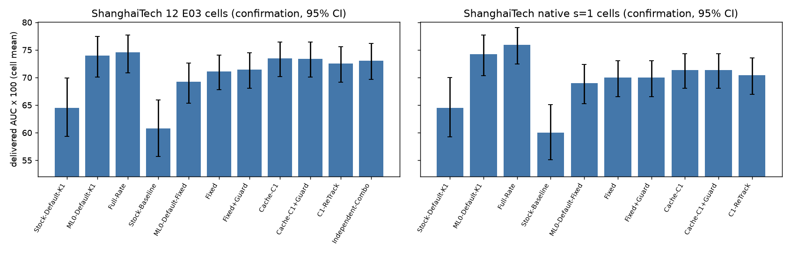
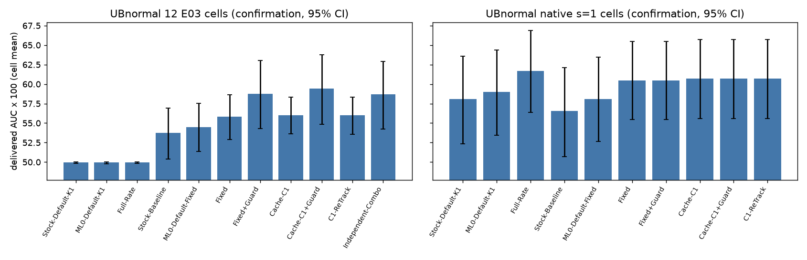
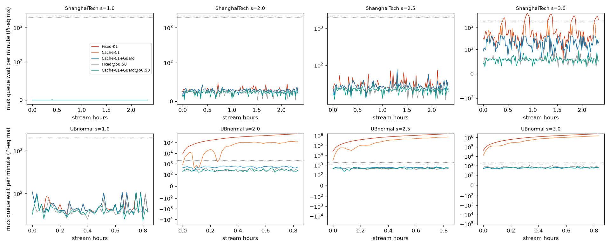
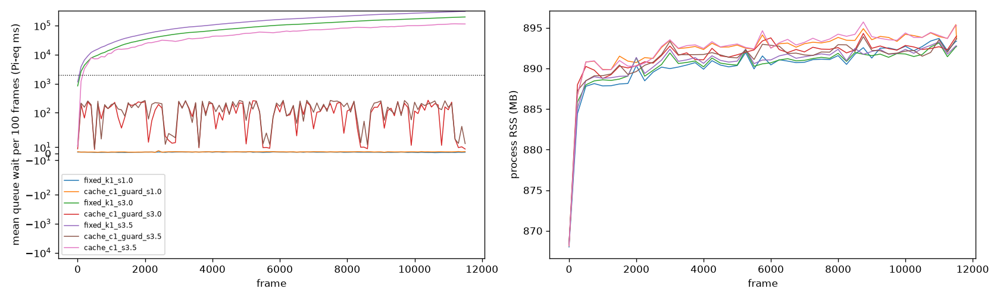

# Q2-P1-E05 — Confirmation: report

**Hardware / honesty disclosure.** The physical Raspberry Pi 5 is **not connected**. Every CPU cost is an `edge-os-arm64-vm` measurement (4 vCPU ARM64 VM on an Apple M2 Pro host) multiplied by a Pi multiplier `s`; the real sustained run (Part C1) is a VM run with *arrivals accelerated by `s`* (the dual of a Pi `s` times slower), and waits are reported in Pi-equivalent ms (= VM ms x `s`). Delivered AUCs are *simulated delivery on replayed detections* (frozen `ML0_ncnn`@640 for ShanghaiTech, the `ML0_mps` proxy for UBnormal, locked BoT-SORT, frozen STG-NF, E00 causal S3/S4 protocol). **No number here is a Pi measurement. No model was trained.** Plan and config were frozen before any E05 evaluation (`plan.md`, `config.yaml`, hash `3d5b4c47eba1…`); post-lock changes are listed as amendments in §9.

*Generated by `edgelab.analysis.q2_p1_e05 report` (seed 20261113, 2026-11-14). Correctness rules: 10/10 pass (all required rules pass).*

## 1. Answer

**Question: does the locked system (`ML0` frontend + locked tracker + Fixed-Burst + C1 detector-output reuse, with an overload guard) hold up on the full protocol, on UBnormal, on short events, on new entries and under sustained operation?**

1. **Lock (V1, ShanghaiTech) — CONFIRMED.** At matched CPU, `Cache-C1 − Fixed` = +2.37 [+1.38, +3.41]* pt on `test_confirmation` (12-cell mean, 2,000-resample paired video bootstrap) and +2.59 [+1.73, +3.47]* on all 107 clips. Net CPU saving of C1 at the same schedule (W=1): 27% at s=1.0, 27% at s=2.0, 27% at s=2.5, 27% at s=3.0 (§3.3).
2. **Replication (V2, UBnormal) — no significant effect (non-negative).** `Cache-C1 − Fixed` = +0.18 [-0.99, +1.39] on the 141 confirmation videos (+0.83 [-0.17, +1.84] on all 211). E03 already showed that on UBnormal the winning arm was `Independent-Combo`, not `Cache-C1`; the replication is therefore a *no-harm* check, and it is reported as such. Per-cell effects are heterogeneous (-5.1 to +6.1 pt): at matched *mean* CPU the unguarded `Cache-C1` queue is unstable in the UB cells with `s ≥ 2` (peak waits up to 1528 s), which `Cache-C1+Guard` fixes (V5).
3. **End to end (V3).** `Cache-C1 − Stock-Baseline` (stock frontend + default tracker + Fixed-Burst at the same CPU): SHT +12.65 [+7.96, +17.41]* — **confirmed**; UB +2.26 [-0.36, +5.14] — **not confirmed** (UB: E01 had already shown no ML0 advantage on UBnormal).
4. **No oracle (V4).** The non-oracle `C1-ReTrack` keeps 62% of the oracle `Cache-C1 − Fixed` gain on SHT (+1.48 [+0.24, +2.62]*) — **holds without oracle identity**; UB 97% (+0.17 [-1.01, +1.41]) — **attenuated**.
5. **Guard (V5).** SHT: no-harm in 13 non-overload cells **non-inferior** (+0.00 [+0.00, +0.00]), overload cells (n=0): **not testable** (n/a). UB: no-harm **non-inferior** (+0.00 [+0.00, +0.00]), overload (n=7): **guard helps** (+5.93 [+1.73, +9.92]*). No-harm cells are those where the unguarded peak wait never exceeds 400 ms (the guard is then bit-identical, E5-D2). **Cost of the guard in mild overload** (unguarded peak wait 400–2,000 ms, the guard acts but nothing would have been dropped): SHT s3.0_b0.75 (peak 1354 ms) -0.04 [-0.28, +0.15]; SHT s3.0_b1.00 (peak 1354 ms) -0.64 [-1.29, -0.14]*; UB s2.0_b0.33 (peak 400 ms) +0.00 [+0.00, +0.00]; UB s2.0_b0.50 (peak 428 ms) +0.01 [+0.00, +0.03]; UB s2.0_b0.67 (peak 1470 ms) +0.05 [-0.30, +0.39]; UB s2.5_b0.50 (peak 1213 ms) -0.20 [-1.68, +1.36].
6. **Short events and new entries (V6/V7, budget cells).** Short events (SHT n=81, UB n=26), recall@1 s `Cache-C1 − Fixed`: SHT -3.3 [-8.7, +2.2] → not shown non-inferior; UB -6.4 [-14.5, +2.4] → not shown non-inferior. New entries (SHT n=144, UB n=100): recall@1 s SHT -0.2 [-2.8, +2.6] → non-inferior, delay p50 -139 [-403, +83] ms → not delayed; UB -1.7 [-4.5, +1.2] → non-inferior, delay -278 [-667, +178] ms → not delayed. **Reading:** new entries are *not* hurt by C1 (both datasets). Short events are **inconclusive, not cleared**: the point estimates are negative on both datasets and the CIs are wide because only 81 / 26 events are short, so the 5-pt non-inferiority margin cannot be established; on SHT short events the detection delay of `Cache-C1` is also longer than `Fixed` (+486 [+0, +1222] ms p50), while the localised AUC on short events does not drop (+1.05 [-1.77, +3.70] pt SHT).
7. **Sustained simulation (V8) — bounded.** `Cache-C1+Guard`: bounded queue in 8/8 (dataset, s) cells (SHT 2.36 h / UB 51.5 min streams). Unguarded arms unbounded in 7 (arm, dataset, s) cases.
8. **Real VM run (V9) — sustained** (latency and memory criteria). 7 runs x 11,520 frames in `edge-os`: with `Cache-C1+Guard` the p99 Pi-equivalent wait is 4 ms at s=1.0, 405 ms at s=3.0, 408 ms at s=3.5 and RSS grows by ≤ 0.4% from frame 2,500, whereas `Fixed-K1` collapses at s = 3.0 / 3.5 (p99 wait 196 s / 307 s, 9,400 of 9,488 windows dropped late at s=3.0).
9. **Important caveat from the real run: the simulation under-estimates real cost by ≈ 1.37x** (real CPU ms per video-second / simulated in the two s = 1.0 runs, which have no queueing or shedding: 1.39x and 1.36x; busy-time capacity of `Fixed-K1` 48 fps = s* ≈ 2.0 vs E02's 3.08). The *relative* C1 saving transfers (26% real vs 24% simulated at s=1), the absolute levels do not. Consequence: the guard keeps the queue bounded but at s = 3.0 / 3.5 the dense `W = 1` schedule sheds 9% / 13% of the frames and its delivered AUC on the looped clips falls to 64.4 / 55.9 (vs 83.0 at s=1; simulation 82.8 / 77.6) - i.e. *bounded latency is confirmed, accuracy under overload is not*. A sparser Fixed-Burst operating point (β ≈ 0.5) was only simulated (C2), not run on the VM; it is the natural next step.

## 2. The E00 → E05 ladder in one page

| step | question | result (all from the frozen artifacts; no re-computation here) |
|---|---|---|
| E00 audit | Can the existing scores / protocol be reproduced? | Yes for scores, windows, normalisation, missing data; SHT is not uniformly 24 fps (rule R7 failed as pre-registered). Causal S3/S4 protocol, splits and sentinels locked. |
| E01 quality | What can the frozen frontend + scorer reach with no CPU limit? | SHT S4: ML0 `ML0_ncnn` 73.78 (76.82 with the locked tracker) vs stock@640 66.03; the P2 head (MLP) is not confirmed; UB shows no ML0 advantage (ML0 58.04 / locked tracker 61.08 vs stock 57.72). |
| E02 fixed baseline | What does an optimised fixed pipeline achieve on the Pi proxy? | K=1 is sustainable up to s* = 3.08 (SHT) / 1.66 (UB); Fixed-Burst is the only fixed schedule that never relabels an old pose as new. |
| E03 ablation | Which mechanisms pay at matched CPU? | Only C1 detector-output reuse pays (SHT Cache-Only − Fixed ≈ +2.4 pt, CPU −29 %); event-aware scheduling does not beat Fixed; joint controller loses after overhead; C2 dropped. UB: `Independent-Combo` was locked, C1 alone ≈ +0.2 [−1.0, +1.5]. |
| E04 optimisations | Do codec motion vectors or INT8 pay on top? | **Neither adopted** (MV: ≈ 0 pt at matched cost; INT8: −1.9 pt confirmation despite −22 % CPU). |
| **E05 confirmation** | Does the locked system survive the full protocol, UB, short events, new entries and sustained operation? | V1 confirmed, V2 no significant effect (non-negative), V3 SHT confirmed / UB not confirmed, V4 holds without oracle identity / attenuated, V8 bounded, V9 sustained. |

Locked system: `ML0_ncnn`@640 (SHT) / `ML0_mps` proxy (UB) → two-stage BoT-SORT (`c=0.20, low=0.05, buffer=30, match=0.85`) → frozen STG-NF with the E00 strict causal completion-landing protocol (hold `H = W_ref − 1`; sentinels SHT `-0.5122`, UB `-0.8273`) scheduled as Fixed-Burst with C1 level 3 (`A1 = 4`), `Cache-C1+Guard` = + hysteresis load-shedding (on > 400 ms, off < 150 ms). MV and INT8 are not part of the system.

## 3. Part A — full-protocol progression (2,000-resample paired video bootstrap, 95 % CI)

Cells: the 12 E03 cells (`s ∈ {2.0, 2.5, 3.0}` x CPU budget `β`) plus the native cells `s = 1.0` x `β ∈ {0.25, 0.50, 1.00}`. All cost-matched arms use the same CPU target per cell (`β x C_full(ML0-locked K=1, s)`); K=1 arms are *not* cost-matched (they run full cadence and overload for `s ≥ s*`). `*` = the CI excludes 0. Ladder steps are paired contrasts.

### 3.1 ShanghaiTech

**Delivered AUC x 100 per arm** (cell mean, bootstrap CI of the mean; `dev` = point on `test_dev`). Mean realised CPU in ms CPU per video-second over the 12 cells in the last column.

| arm | dev (12 cells) | confirmation (12 cells) | all (12 cells) | confirmation (native s=1, 3 cells) | CPU ms/s |
|---|---|---|---|---|---|
| 1. Stock frontend, default tracker, K=1 | 65.18 | 64.46 [59.31, 69.95] | 64.92 [60.92, 69.00] | 64.49 [59.27, 69.96] | 2515 |
| 2. ML0 frontend, default tracker, K=1 | 72.02 | 73.94 [70.12, 77.40] | 73.39 [70.50, 76.11] | 74.21 [70.32, 77.65] | 2667 |
| 3. ML0 + locked tracker, K=1 (Full-Rate) | 72.36 | 74.54 [70.87, 77.72] | 73.84 [70.70, 76.89] | 75.91 [72.43, 79.04] | 2703 |
| 4. Fixed-Burst (cost-matched) | 70.10 | 71.06 [67.77, 74.09] | 70.84 [68.26, 73.33] | 69.96 [66.49, 73.08] | 1835 |
| 5a. Cache-C1 (primary, oracle identity) | 73.12 | 73.43 [70.13, 76.46] | 73.43 [70.81, 75.95] | 71.34 [68.05, 74.35] | 1634 |
| 5b. Cache-C1+Guard | 73.06 | 73.38 [70.06, 76.44] | 73.37 [70.76, 75.86] | 71.34 [68.05, 74.35] | 1633 |
| ctl. Stock-Baseline (stock + default tracker, Fixed-Burst) | 60.80 | 60.78 [55.71, 65.91] | 61.07 [57.13, 64.96] | 60.05 [55.07, 65.09] | 1782 |
| ctl. ML0 + default tracker, Fixed-Burst | 67.46 | 69.23 [65.38, 72.64] | 68.73 [65.68, 71.58] | 68.98 [65.22, 72.33] | 1824 |
| ctl. Fixed+Guard | 71.31 | 71.42 [68.09, 74.50] | 71.50 [68.91, 73.83] | 69.96 [66.49, 73.08] | 1833 |
| ctl. C1-ReTrack (non-oracle) | 72.55 | 72.54 [69.15, 75.61] | 72.68 [70.07, 75.21] | 70.43 [66.99, 73.58] | 1635 |
| ctl. C1-ReTrack+Guard | 72.49 | 72.48 [69.10, 75.58] | 72.62 [70.00, 75.16] | 70.43 [66.99, 73.58] | 1634 |
| ref. E03 Independent-Combo (12 cells) | 72.89 | 73.06 [69.62, 76.15] | 73.13 [70.47, 75.64] | n/a | n/a |

**Ladder contrasts** (A − B, AUC points; 12-cell mean unless stated; confirmation / all / native cells / overload cell s=3, β=1.0):

| contrast | confirmation, 12 cells | all clips, 12 cells | confirmation, native 3 cells | confirmation, s=3.0 β=1.0 |
|---|---|---|---|---|
| ML0-Default-K1 − Stock-Default-K1 (frontend) | +9.49 [+5.14, +13.78]* | +8.47 [+5.32, +11.61]* | +9.72 [+5.39, +14.02]* | +8.91 [+4.57, +13.30]* |
| Full-Rate − ML0-Default-K1 (locked tracker) | +0.60 [-1.27, +2.62] | +0.45 [-1.27, +2.27] | +1.70 [+0.12, +3.46]* | -2.76 [-7.70, +1.42] |
| Fixed − Full-Rate (cost of the budget) | -3.48 [-5.09, -1.91]* | -3.00 [-4.62, -1.50]* | -5.94 [-7.85, -4.07]* | +0.00 [+0.00, +0.00] |
| **Cache-C1 − Fixed (the lock)** | +2.37 [+1.38, +3.41]* | +2.59 [+1.73, +3.47]* | +1.38 [+0.29, +2.56]* | +4.67 [+0.97, +9.26]* |
| Cache-C1+Guard − Cache-C1 | -0.06 [-0.12, -0.01]* | -0.06 [-0.11, -0.02]* | +0.00 [+0.00, +0.00] | -0.64 [-1.29, -0.14]* |
| **Cache-C1 − Stock-Baseline (end to end)** | +12.65 [+7.96, +17.41]* | +12.36 [+9.01, +15.83]* | +11.29 [+6.74, +15.82]* | +10.82 [+6.16, +15.52]* |
| Cache-C1+Guard − Stock-Baseline | +12.60 [+7.87, +17.32]* | +12.31 [+8.93, +15.76]* | +11.29 [+6.74, +15.82]* | +10.19 [+5.20, +15.00]* |
| Fixed − Stock-Baseline | +10.28 [+5.65, +14.95]* | +9.77 [+6.50, +13.11]* | +9.92 [+5.47, +14.29]* | +6.16 [-0.45, +12.72] |
| Fixed − ML0-Default-Fixed | +1.83 [-0.03, +3.89] | +2.10 [+0.63, +3.70]* | +0.98 [-0.74, +2.77] | -2.76 [-7.70, +1.42] |
| Cache-C1 − Full-Rate (reuse vs full cadence) | -1.10 [-2.43, +0.32] | -0.41 [-1.92, +1.14] | -4.57 [-6.29, -3.02]* | +4.67 [+0.97, +9.26]* |
| Fixed+Guard − Fixed | +0.36 [+0.05, +0.76]* | +0.67 [+0.25, +1.15]* | +0.00 [+0.00, +0.00] | +4.29 [+0.56, +9.09]* |
| C1-ReTrack − Fixed (non-oracle) | +1.48 [+0.24, +2.62]* | +1.84 [+0.91, +2.84]* | +0.46 [-1.08, +1.94] | +3.48 [-0.49, +8.13] |
| C1-ReTrack − Cache-C1 (price of identity) | -0.89 [-1.73, -0.20]* | -0.75 [-1.35, -0.22]* | -0.91 [-2.02, +0.01] | -1.19 [-2.23, -0.25]* |
| C1-ReTrack+Guard − Fixed | +1.42 [+0.16, +2.57]* | +1.78 [+0.83, +2.78]* | +0.46 [-1.08, +1.94] | +2.80 [-1.28, +7.58] |
| Cache-C1+Guard − Independent-Combo | +0.32 [-0.28, +0.92] | +0.25 [-0.25, +0.75] | n/a | +0.71 [-0.13, +1.54] |
| Cache-C1 − Independent-Combo | +0.38 [-0.22, +0.99] | +0.30 [-0.19, +0.81] | n/a | +1.35 [+0.27, +2.47]* |

**`Cache-C1 − Fixed` per cell (confirmation)**

| cell | Fixed period W | Fixed | Cache-C1 | Cache-C1 − Fixed (conf) | (all) | Cache-C1 peak wait ms | Guard − Cache-C1 (conf) |
|---|---|---|---|---|---|---|---|
| s2.0_b0.25 | 87.4 | 62.93 | 66.77 | +3.83 [+0.98, +6.74]* | +2.21 [-0.43, +4.80] | 27 | +0.00 [+0.00, +0.00] |
| s2.0_b0.33 | 64.2 | 67.93 | 70.29 | +2.36 [-0.46, +5.66] | +2.97 [+0.65, +5.50]* | 27 | +0.00 [+0.00, +0.00] |
| s2.0_b0.50 | 41.1 | 71.04 | 71.18 | +0.15 [-1.86, +2.32] | +0.81 [-0.89, +2.52] | 29 | +0.00 [+0.00, +0.00] |
| s2.0_b0.67 | 30.1 | 70.61 | 75.89 | +5.27 [+3.05, +7.59]* | +4.93 [+3.28, +6.72]* | 42 | +0.00 [+0.00, +0.00] |
| s2.0_b0.75 | 26.8 | 72.06 | 76.02 | +3.96 [+1.98, +6.09]* | +3.37 [+1.66, +5.11]* | 42 | +0.00 [+0.00, +0.00] |
| s2.0_b1.00 | 1.0 | 75.92 | 76.06 | +0.14 [-0.10, +0.36] | +0.12 [-0.10, +0.32] | 42 | +0.00 [+0.00, +0.00] |
| s2.5_b0.50 | 41.1 | 71.04 | 71.17 | +0.14 [-1.86, +2.29] | +0.80 [-0.89, +2.50] | 46 | +0.00 [+0.00, +0.00] |
| s2.5_b0.75 | 26.8 | 72.03 | 75.99 | +3.96 [+1.98, +6.07]* | +3.37 [+1.67, +5.11]* | 64 | +0.00 [+0.00, +0.00] |
| s2.5_b1.00 | 1.0 | 75.75 | 75.87 | +0.12 [-0.19, +0.38] | +0.14 [-0.11, +0.37] | 64 | +0.00 [+0.00, +0.00] |
| s3.0_b0.50 | 41.1 | 70.90 | 71.09 | +0.18 [-1.81, +2.35] | +0.79 [-0.90, +2.49] | 68 | +0.00 [+0.00, +0.00] |
| s3.0_b0.75 | 26.8 | 71.96 | 75.66 | +3.70 [+1.77, +5.79]* | +3.13 [+1.50, +4.84]* | 1354 | -0.04 [-0.28, +0.15] |
| s3.0_b1.00 | 1.0 | 70.56 | 75.22 | +4.67 [+0.97, +9.26]* | +8.51 [+3.63, +13.97]* | 1354 | -0.64 [-1.29, -0.14]* |
| s1.0_b0.25 | 87.4 | 62.95 | 66.77 | +3.82 [+0.97, +6.74]* | +2.21 [-0.42, +4.80] | 0 | +0.00 [+0.00, +0.00] |
| s1.0_b0.50 | 41.1 | 71.03 | 71.19 | +0.16 [-1.84, +2.33] | +0.82 [-0.87, +2.53] | 0 | +0.00 [+0.00, +0.00] |
| s1.0_b1.00 | 1.0 | 75.91 | 76.06 | +0.16 [-0.06, +0.36] | +0.13 [-0.07, +0.31] | 0 | +0.00 [+0.00, +0.00] |

**Event metrics, 12-cell mean (confirmation clips; recall in % of events, delay of detected events in ms, bootstrap 95 % CI)**

| arm | events | recall@0.5 s | recall@1 s | recall@2 s | missed % | delay p50 ms | false alerts / normal h |
|---|---|---|---|---|---|---|---|
| Stock-Default-K1 | 129 | 4.7 [1.5, 8.8] | 9.5 [4.7, 15.3] | 26.7 [17.3, 37.5] | 58.3 [46.1, 68.8] | 1500 [1344, 1917] | 26.3 |
| ML0-Default-K1 | 129 | 6.2 [2.5, 10.7] | 8.3 [4.1, 13.8] | 33.9 [24.3, 45.5] | 48.3 [35.2, 59.2] | 1531 [1385, 1885] | 30.2 |
| Full-Rate | 129 | 5.8 [2.3, 10.3] | 8.7 [4.3, 14.0] | 34.9 [24.8, 47.0] | 48.4 [35.2, 59.9] | 1479 [1385, 1761] | 30.2 |
| Stock-Baseline | 129 | 3.9 [1.3, 7.0] | 5.7 [2.9, 9.2] | 16.4 [10.6, 23.6] | 67.9 [57.9, 76.1] | 2042 [1681, 2406] | 11.4 |
| Fixed | 129 | 7.6 [4.2, 11.5] | 8.7 [5.2, 12.7] | 25.5 [18.6, 33.8] | 55.0 [43.9, 64.2] | 1823 [1687, 2101] | 19.7 |
| Cache-C1 | 129 | 6.3 [3.0, 10.4] | 8.6 [4.7, 13.3] | 30.3 [21.5, 40.5] | 51.2 [38.8, 61.5] | 1705 [1601, 1878] | 28.5 |
| Cache-C1+Guard | 129 | 6.3 [3.0, 10.4] | 8.6 [4.7, 13.3] | 30.3 [21.5, 40.5] | 51.2 [38.8, 61.5] | 1705 [1601, 1878] | 28.5 |
| C1-ReTrack | 129 | 6.3 [3.1, 10.3] | 8.1 [4.4, 12.7] | 28.8 [20.5, 38.6] | 53.2 [41.4, 63.2] | 1708 [1597, 1917] | 26.3 |

| event contrast (confirmation) | Δ recall@0.5 s (pt) | Δ recall@1 s (pt) | Δ recall@2 s (pt) | Δ missed (pt) | Δ delay p50 (ms) |
|---|---|---|---|---|---|
| **Cache-C1 − Fixed (the lock)** | -1.3 [-2.9, +0.1] | -0.1 [-2.2, +2.0] | +4.8 [+1.3, +8.5]* | -3.8 [-6.9, -0.9]* | -118 [-292, +7] |
| **Cache-C1 − Stock-Baseline (end to end)** | +2.5 [+0.7, +4.7]* | +2.8 [+0.5, +5.6]* | +13.9 [+8.6, +19.8]* | -16.7 [-23.6, -10.6]* | -337 [-625, +7] |
| Cache-C1+Guard − Cache-C1 | +0.0 [+0.0, +0.0] | +0.0 [+0.0, +0.0] | +0.0 [+0.0, +0.0] | +0.0 [+0.0, +0.0] | +0 [-7, +0] |
| C1-ReTrack − Fixed (non-oracle) | -1.3 [-2.8, +0.0] | -0.6 [-2.4, +1.4] | +3.3 [-0.1, +6.9] | -1.8 [-5.2, +1.6] | -115 [-278, +21] |
| Cache-C1 − Full-Rate (reuse vs full cadence) | +0.5 [-0.5, +1.6] | -0.1 [-1.6, +1.2] | -4.6 [-7.3, -2.2]* | +2.7 [+0.2, +5.5]* | +226 [+90, +316]* |

### 3.2 UBnormal

**Delivered AUC x 100 per arm** (cell mean, bootstrap CI of the mean; `dev` = point on `test_dev`). Mean realised CPU in ms CPU per video-second over the 12 cells in the last column.

| arm | dev (12 cells) | confirmation (12 cells) | all (12 cells) | confirmation (native s=1, 3 cells) | CPU ms/s |
|---|---|---|---|---|---|
| 1. Stock frontend, default tracker, K=1 | 50.09 | 49.95 [49.81, 50.05] | 50.00 [49.88, 50.10] | 58.10 [52.36, 63.55] | 4675 |
| 2. ML0 frontend, default tracker, K=1 | 50.09 | 49.94 [49.79, 50.04] | 49.99 [49.87, 50.10] | 59.00 [53.43, 64.36] | 4784 |
| 3. ML0 + locked tracker, K=1 (Full-Rate) | 50.10 | 49.96 [49.84, 50.04] | 50.01 [49.90, 50.11] | 61.66 [56.38, 66.90] | 4826 |
| 4. Fixed-Burst (cost-matched) | 52.35 | 55.82 [52.88, 58.64] | 54.68 [52.36, 57.13] | 60.49 [55.47, 65.48] | 3227 |
| 5a. Cache-C1 (primary, oracle identity) | 54.51 | 56.00 [53.62, 58.35] | 55.51 [53.61, 57.51] | 60.70 [55.58, 65.74] | 3024 |
| 5b. Cache-C1+Guard | 56.08 | 59.45 [54.85, 63.78] | 58.34 [54.63, 61.99] | 60.70 [55.58, 65.74] | 2557 |
| ctl. Stock-Baseline (stock + default tracker, Fixed-Burst) | 52.39 | 53.74 [50.40, 56.90] | 53.34 [50.75, 55.78] | 56.56 [50.71, 62.11] | 3213 |
| ctl. ML0 + default tracker, Fixed-Burst | 51.65 | 54.46 [51.37, 57.52] | 53.53 [51.06, 56.15] | 58.09 [52.62, 63.48] | 3213 |
| ctl. Fixed+Guard | 53.86 | 58.75 [54.30, 63.03] | 57.15 [53.59, 60.80] | 60.49 [55.47, 65.48] | 2654 |
| ctl. C1-ReTrack (non-oracle) | 54.30 | 55.99 [53.58, 58.35] | 55.44 [53.55, 57.44] | 60.74 [55.58, 65.70] | 3027 |
| ctl. C1-ReTrack+Guard | 55.67 | 59.69 [55.15, 63.96] | 58.37 [54.77, 62.06] | 60.74 [55.58, 65.70] | 2558 |
| ref. E03 Independent-Combo (12 cells) | 54.53 | 58.72 [54.23, 62.93] | 57.33 [53.74, 60.83] | n/a | n/a |

**Ladder contrasts** (A − B, AUC points; 12-cell mean unless stated; confirmation / all / native cells / overload cell s=3, β=1.0):

| contrast | confirmation, 12 cells | all clips, 12 cells | confirmation, native 3 cells | confirmation, s=3.0 β=1.0 |
|---|---|---|---|---|
| ML0-Default-K1 − Stock-Default-K1 (frontend) | -0.01 [-0.03, +0.00] | -0.01 [-0.02, +0.00] | +0.91 [-3.14, +5.05] | -0.00 [-0.01, +0.00] |
| Full-Rate − ML0-Default-K1 (locked tracker) | +0.01 [-0.00, +0.05] | +0.01 [-0.00, +0.04] | +2.66 [+0.56, +4.74]* | +0.00 [+0.00, +0.00] |
| Fixed − Full-Rate (cost of the budget) | +5.86 [+2.95, +8.72]* | +4.68 [+2.39, +7.12]* | -1.17 [-2.33, -0.06]* | +0.00 [+0.00, +0.00] |
| **Cache-C1 − Fixed (the lock)** | +0.18 [-0.99, +1.39] | +0.83 [-0.17, +1.84] | +0.21 [-0.91, +1.27] | -0.02 [-0.20, +0.12] |
| Cache-C1+Guard − Cache-C1 | +3.45 [+0.97, +5.80]* | +2.83 [+0.84, +4.82]* | +0.00 [+0.00, +0.00] | +6.52 [+1.86, +11.02]* |
| **Cache-C1 − Stock-Baseline (end to end)** | +2.26 [-0.36, +5.14] | +2.17 [+0.05, +4.39]* | +4.14 [-0.15, +8.69] | -0.03 [-0.20, +0.11] |
| Cache-C1+Guard − Stock-Baseline | +5.71 [+2.09, +9.31]* | +5.00 [+2.07, +8.12]* | +4.14 [-0.15, +8.69] | +6.49 [+1.83, +10.94]* |
| Fixed − Stock-Baseline | +2.08 [-0.28, +4.59] | +1.34 [-0.58, +3.42] | +3.93 [-0.22, +8.20] | -0.00 [-0.01, +0.00] |
| Fixed − ML0-Default-Fixed | +1.36 [+0.35, +2.47]* | +1.15 [+0.21, +2.23]* | +2.40 [+0.60, +4.36]* | +0.00 [+0.00, +0.00] |
| Cache-C1 − Full-Rate (reuse vs full cadence) | +6.04 [+3.67, +8.39]* | +5.50 [+3.62, +7.50]* | -0.96 [-1.91, -0.04]* | -0.02 [-0.20, +0.12] |
| Fixed+Guard − Fixed | +2.93 [+1.33, +4.46]* | +2.46 [+1.24, +3.73]* | +0.00 [+0.00, +0.00] | +4.27 [+1.11, +7.42]* |
| C1-ReTrack − Fixed (non-oracle) | +0.17 [-1.01, +1.41] | +0.75 [-0.26, +1.76] | +0.25 [-0.85, +1.32] | -0.03 [-0.20, +0.12] |
| C1-ReTrack − Cache-C1 (price of identity) | -0.01 [-0.15, +0.14] | -0.07 [-0.19, +0.04] | +0.04 [-0.19, +0.27] | -0.00 [-0.01, +0.00] |
| C1-ReTrack+Guard − Fixed | +3.87 [+1.91, +5.70]* | +3.68 [+2.04, +5.32]* | +0.25 [-0.85, +1.32] | +6.82 [+2.16, +11.32]* |
| Cache-C1+Guard − Independent-Combo | +0.73 [+0.01, +1.43]* | +1.01 [+0.44, +1.62]* | n/a | +0.44 [-1.07, +1.87] |
| Cache-C1 − Independent-Combo | -2.72 [-5.09, -0.35]* | -1.82 [-3.84, +0.24] | n/a | -6.08 [-10.35, -1.49]* |

**`Cache-C1 − Fixed` per cell (confirmation)**

| cell | Fixed period W | Fixed | Cache-C1 | Cache-C1 − Fixed (conf) | (all) | Cache-C1 peak wait ms | Guard − Cache-C1 (conf) |
|---|---|---|---|---|---|---|---|
| s2.0_b0.25 | 72.6 | 59.74 | 60.26 | +0.51 [-1.92, +3.03] | +1.25 [-0.96, +3.35] | 360 | +0.00 [+0.00, +0.00] |
| s2.0_b0.33 | 53.4 | 58.91 | 60.41 | +1.50 [-0.68, +3.54] | +1.12 [-0.72, +3.00] | 400 | +0.00 [+0.00, +0.00] |
| s2.0_b0.50 | 31.1 | 60.05 | 59.98 | -0.07 [-1.79, +1.62] | +0.67 [-0.75, +2.08] | 428 | +0.01 [+0.00, +0.03] |
| s2.0_b0.67 | 21.8 | 60.10 | 61.69 | +1.59 [+0.40, +2.77]* | +1.28 [+0.17, +2.39]* | 1470 | +0.05 [-0.30, +0.39] |
| s2.0_b0.75 | 19.8 | 61.23 | 56.10 | -5.13 [-11.02, +0.73] | -2.78 [-7.74, +1.86] | 54941 | +5.97 [+0.15, +11.79]* |
| s2.0_b1.00 | 1.0 | 49.92 | 55.98 | +6.06 [+3.17, +9.31]* | +6.56 [+4.11, +9.28]* | 125251 | +5.06 [-0.33, +10.27] |
| s2.5_b0.50 | 31.1 | 60.01 | 59.96 | -0.05 [-1.74, +1.69] | +0.64 [-0.77, +2.09] | 1213 | -0.20 [-1.68, +1.36] |
| s2.5_b0.75 | 19.8 | 49.91 | 51.64 | +1.73 [+0.22, +3.57]* | +2.20 [+0.72, +3.92]* | 513120 | +8.98 [+3.77, +13.96]* |
| s2.5_b1.00 | 1.0 | 50.01 | 49.98 | -0.02 [-0.44, +0.33] | +0.01 [-0.31, +0.28] | 762367 | +9.19 [+4.05, +13.69]* |
| s3.0_b0.50 | 31.1 | 60.04 | 56.04 | -4.00 [-9.55, +1.52] | -1.13 [-5.79, +3.33] | 67287 | -1.32 [-5.98, +2.98] |
| s3.0_b0.75 | 19.8 | 49.94 | 49.99 | +0.05 [-0.03, +0.17] | +0.10 [-0.01, +0.28] | 1195982 | +7.12 [+2.60, +11.50]* |
| s3.0_b1.00 | 1.0 | 49.98 | 49.96 | -0.02 [-0.20, +0.12] | -0.00 [-0.13, +0.10] | 1527898 | +6.52 [+1.86, +11.02]* |
| s1.0_b0.25 | 72.6 | 59.73 | 60.39 | +0.66 [-1.75, +3.15] | +1.35 [-0.87, +3.43] | 101 | +0.00 [+0.00, +0.00] |
| s1.0_b0.50 | 31.1 | 60.08 | 60.06 | -0.02 [-1.75, +1.63] | +0.63 [-0.79, +2.03] | 106 | +0.00 [+0.00, +0.00] |
| s1.0_b1.00 | 1.0 | 61.66 | 61.65 | -0.01 [-0.24, +0.21] | -0.11 [-0.31, +0.07] | 111 | +0.00 [+0.00, +0.00] |

**Event metrics, 12-cell mean (confirmation clips; recall in % of events, delay of detected events in ms, bootstrap 95 % CI)**

| arm | events | recall@0.5 s | recall@1 s | recall@2 s | missed % | delay p50 ms | false alerts / normal h |
|---|---|---|---|---|---|---|---|
| Stock-Default-K1 | 133 | 0.0 [0.0, 0.0] | 0.0 [0.0, 0.0] | 0.4 [0.0, 1.2] | 99.6 [98.8, 100.0] | 1200 [1200, 1200] | 0.0 |
| ML0-Default-K1 | 133 | 0.0 [0.0, 0.0] | 0.0 [0.0, 0.0] | 0.0 [0.0, 0.0] | 100.0 [100.0, 100.0] | n/a [n/a, n/a] | 0.0 |
| Full-Rate | 133 | 0.0 [0.0, 0.0] | 0.0 [0.0, 0.0] | 0.0 [0.0, 0.0] | 100.0 [100.0, 100.0] | n/a [n/a, n/a] | 0.0 |
| Stock-Baseline | 133 | 3.4 [1.7, 5.6] | 6.6 [4.1, 9.4] | 11.8 [8.5, 15.4] | 76.9 [72.4, 81.1] | 1838 [1421, 3353] | 28.7 |
| Fixed | 133 | 5.1 [3.3, 7.3] | 8.1 [5.5, 10.8] | 15.7 [12.3, 19.5] | 71.4 [67.0, 75.4] | 1790 [1414, 2472] | 57.1 |
| Cache-C1 | 133 | 5.0 [3.1, 7.1] | 8.3 [5.7, 11.3] | 15.9 [12.1, 19.8] | 73.7 [69.5, 77.8] | 1570 [1300, 2357] | 49.6 |
| Cache-C1+Guard | 133 | 8.2 [5.4, 11.5] | 13.5 [9.6, 17.9] | 26.7 [20.9, 32.8] | 55.2 [48.9, 61.7] | 1761 [1436, 2375] | 88.7 |
| C1-ReTrack | 133 | 4.9 [3.1, 7.1] | 8.2 [5.6, 11.1] | 15.6 [11.9, 19.6] | 73.2 [69.1, 77.4] | 1573 [1327, 2541] | 48.7 |

| event contrast (confirmation) | Δ recall@0.5 s (pt) | Δ recall@1 s (pt) | Δ recall@2 s (pt) | Δ missed (pt) | Δ delay p50 (ms) |
|---|---|---|---|---|---|
| **Cache-C1 − Fixed (the lock)** | -0.1 [-1.1, +0.9] | +0.3 [-1.3, +1.9] | +0.1 [-2.0, +2.3] | +2.3 [-0.1, +4.7] | -221 [-623, +416] |
| **Cache-C1 − Stock-Baseline (end to end)** | +1.6 [-0.6, +3.7] | +1.7 [-1.1, +4.6] | +4.0 [-0.1, +8.0] | -3.3 [-8.0, +1.5] | -268 [-1531, +355] |
| Cache-C1+Guard − Cache-C1 | +3.2 [+1.8, +4.8]* | +5.2 [+3.4, +7.3]* | +10.8 [+8.1, +13.7]* | -18.5 [-21.7, -15.1]* | +191 [-347, +585] |
| C1-ReTrack − Fixed (non-oracle) | -0.1 [-1.2, +0.9] | +0.1 [-1.4, +1.8] | -0.1 [-2.2, +2.1] | +1.9 [-0.7, +4.4] | -218 [-550, +559] |
| Cache-C1 − Full-Rate (reuse vs full cadence) | +5.0 [+3.1, +7.1]* | +8.3 [+5.7, +11.3]* | +15.9 [+12.1, +19.8]* | -26.3 [-30.5, -22.2]* | n/a |

### 3.3 CPU at the same schedule (W = 1, β = 1.0 cells where `Cache-C1` runs at W = 1)

| dataset | s | Full-Rate CPU ms/s | Cache-C1 CPU ms/s | saving |
|---|---|---|---|---|
| ShanghaiTech | 1.0 | 1138 | 834 | 26.7 % |
| ShanghaiTech | 2.0 | 2276 | 1669 | 26.7 % |
| ShanghaiTech | 2.5 | 2845 | 2086 | 26.7 % |
| ShanghaiTech | 3.0 | 3414 | 2503 | 26.7 % |
| UBnormal | 1.0 | 2032 | 1651 | 18.7 % |
| UBnormal | 2.0 | 4064 | 3302 | 18.7 % |
| UBnormal | 2.5 | 5080 | 4128 | 18.7 % |
| UBnormal | 3.0 | 6096 | 4953 | 18.7 % |

## 4. Part B — stratified subgroup analysis (all ground-truth events)

Partitions (each event is in exactly one level per stratum, rule E5-D9): **duration** short ≤ 2.5 s (60 frames SHT / 75 UB) vs sustained; **new-person entry**: a track (≥ 12 poses, first frame ≥ 3) of the K=1 locked tracker starts within ±1 s of the event onset; **motion**: p90 of the E03 ROI motion signal over the first second ≥ the E03 `test_dev` q85 threshold; **crowd**: median number of simultaneous K=1 tracks over the first second ≥ 4. Metrics per level: event recall @0.5/1/2 s, missed rate, detection delay p50/p90 (detected events) and the **localised event-window AUC** on `[s − 2 s, e + 2 s]` (delivered series). Cell group *budget* = `s=2.0` x `β ∈ {0.33, 0.50, 0.75}` (mean of per-cell values); *overload* = `s=3.0, β=1.0`; *native* = `s=1.0, β=1.0`. Clip-level paired bootstrap (all clips), 2,000 resamples; no multiplicity correction.

### 4.1 ShanghaiTech (194 events: short 81, new entry 144, fast 56, crowd 105)

**Budget cells (s=2.0, β ∈ {0.33, 0.50, 0.75}), per level and arm**

| level | n | arm | recall@0.5 s % | recall@1 s % | recall@2 s % | missed % | delay p50 ms | delay p90 ms | localised AUC |
|---|---|---|---|---|---|---|---|---|---|
| all events | 194 | Full-Rate | 7.7 [4.2, 11.6] | 10.8 [6.4, 15.9] | 39.7 [31.0, 48.9] | 44.8 [35.0, 53.8] | 1458 [1375, 1583] | 4083 [3167, 5500] | 68.0 [64.9, 71.1] |
|  |  | Fixed | 10.7 [7.1, 14.3] | 11.3 [7.6, 15.1] | 25.4 [20.0, 31.4] | 54.5 [46.6, 61.8] | 1875 [1611, 2153] | 4014 [3458, 5403] | 59.5 [56.8, 62.1] |
|  |  | Cache-C1 | 7.7 [4.6, 11.1] | 10.3 [6.6, 14.7] | 29.6 [23.0, 37.1] | 50.9 [41.9, 58.6] | 1792 [1681, 1986] | 4403 [3444, 5986] | 62.2 [59.4, 64.9] |
|  |  | Cache-C1+Guard | 7.7 [4.6, 11.1] | 10.3 [6.6, 14.7] | 29.6 [23.0, 37.1] | 50.9 [41.9, 58.6] | 1792 [1681, 1986] | 4403 [3444, 5986] | 62.2 [59.4, 64.9] |
|  |  | C1-ReTrack | 7.2 [4.2, 10.4] | 9.6 [6.0, 13.7] | 27.5 [21.4, 34.5] | 53.6 [45.0, 61.1] | 1792 [1639, 2000] | 4306 [3319, 5542] | 61.3 [58.6, 64.0] |
|  |  | Stock-Baseline | 6.7 [3.7, 10.2] | 7.4 [4.1, 11.2] | 16.2 [11.3, 21.7] | 67.0 [58.9, 74.1] | 1986 [1639, 2445] | 4236 [3486, 5569] | 51.5 [48.4, 54.9] |
| short (<= 2.5 s) | 81 | Full-Rate | 11.1 [4.9, 18.9] | 13.6 [6.7, 22.9] | 25.9 [14.9, 40.0] | 74.1 [60.0, 85.1] | 917 [0, 1333] | 1458 [1375, 1708] | 63.6 [57.4, 69.7] |
|  |  | Fixed | 15.2 [8.7, 22.1] | 15.2 [8.7, 22.1] | 21.8 [14.0, 30.9] | 77.8 [68.6, 85.7] | 14 [0, 625] | 1611 [1125, 1958] | 56.4 [50.3, 62.7] |
|  |  | Cache-C1 | 9.9 [4.5, 16.9] | 11.9 [5.9, 19.8] | 20.2 [11.4, 31.5] | 79.0 [67.7, 87.8] | 500 [0, 1389] | 1694 [1472, 2056] | 57.4 [51.5, 63.7] |
|  |  | Cache-C1+Guard | 9.9 [4.5, 16.9] | 11.9 [5.9, 19.8] | 20.2 [11.4, 31.5] | 79.0 [67.7, 87.8] | 500 [0, 1389] | 1694 [1472, 2056] | 57.4 [51.5, 63.7] |
|  |  | C1-ReTrack | 9.5 [4.5, 15.9] | 11.1 [5.6, 18.6] | 18.5 [10.6, 29.1] | 80.7 [69.9, 88.9] | 333 [0, 1319] | 1764 [1403, 2000] | 57.2 [51.1, 63.8] |
|  |  | Stock-Baseline | 9.9 [4.6, 16.7] | 9.9 [4.6, 16.7] | 15.2 [8.1, 24.6] | 84.8 [75.4, 91.9] | 0 [0, 876] | 1583 [1042, 1694] | 49.7 [42.5, 57.5] |
| sustained (> 2.5 s) | 113 | Full-Rate | 5.3 [1.8, 9.8] | 8.8 [3.8, 14.0] | 49.6 [40.0, 59.6] | 23.9 [15.4, 33.0] | 1500 [1417, 1833] | 5417 [3417, 5833] | 67.5 [63.9, 71.0] |
|  |  | Fixed | 7.4 [3.6, 11.5] | 8.6 [4.5, 13.0] | 28.0 [21.5, 34.7] | 37.8 [29.7, 45.8] | 2250 [1958, 2528] | 4403 [3681, 5986] | 58.4 [55.5, 61.2] |
|  |  | Cache-C1 | 6.2 [2.6, 10.6] | 9.1 [4.7, 14.0] | 36.3 [29.0, 43.9] | 30.7 [22.3, 39.2] | 1972 [1792, 2194] | 5139 [3666, 6319] | 61.3 [58.1, 64.4] |
|  |  | Cache-C1+Guard | 6.2 [2.6, 10.6] | 9.1 [4.7, 14.0] | 36.3 [29.0, 43.9] | 30.7 [22.3, 39.2] | 1972 [1792, 2194] | 5139 [3666, 6319] | 61.3 [58.1, 64.4] |
|  |  | C1-ReTrack | 5.6 [2.2, 9.8] | 8.6 [4.4, 13.2] | 33.9 [26.9, 41.4] | 34.2 [25.5, 42.9] | 1958 [1792, 2250] | 5028 [3569, 5750] | 60.4 [57.4, 63.4] |
|  |  | Stock-Baseline | 4.4 [1.5, 8.3] | 5.6 [2.1, 9.6] | 16.8 [11.4, 22.4] | 54.3 [45.8, 62.4] | 2458 [2139, 2708] | 4583 [3639, 6097] | 51.3 [48.1, 54.6] |
| new person within +-1 s of onset | 144 | Full-Rate | 5.6 [2.2, 9.6] | 9.0 [4.7, 14.0] | 45.1 [35.9, 55.5] | 40.3 [30.3, 50.3] | 1458 [1375, 1500] | 3625 [2667, 5458] | 70.4 [67.4, 73.4] |
|  |  | Fixed | 7.9 [4.7, 11.3] | 8.6 [5.2, 12.1] | 25.5 [19.9, 31.9] | 50.2 [42.0, 58.0] | 2000 [1736, 2319] | 4000 [3444, 5348] | 60.3 [57.5, 63.0] |
|  |  | Cache-C1 | 5.6 [2.5, 9.1] | 8.3 [4.5, 12.9] | 31.9 [25.1, 39.6] | 46.3 [37.5, 55.1] | 1861 [1708, 2042] | 4097 [3236, 5931] | 64.0 [61.0, 66.8] |
|  |  | Cache-C1+Guard | 5.6 [2.5, 9.1] | 8.3 [4.5, 12.9] | 31.9 [25.1, 39.6] | 46.3 [37.5, 55.1] | 1861 [1708, 2042] | 4097 [3236, 5931] | 64.0 [61.0, 66.8] |
|  |  | C1-ReTrack | 5.1 [2.3, 8.4] | 7.6 [4.2, 11.8] | 29.6 [23.1, 37.2] | 49.8 [40.9, 58.2] | 1806 [1694, 2069] | 3958 [3194, 5347] | 63.0 [60.0, 65.8] |
|  |  | Stock-Baseline | 5.6 [2.6, 8.9] | 6.0 [2.9, 9.5] | 16.4 [11.3, 22.3] | 64.1 [55.5, 71.8] | 2181 [1736, 2514] | 3944 [3361, 5528] | 53.6 [50.1, 57.1] |
| no new entry near onset | 50 | Full-Rate | 14.0 [4.5, 26.2] | 16.0 [4.8, 30.0] | 24.0 [11.4, 41.0] | 58.0 [37.5, 73.5] | 1458 [167, 2833] | 6000 [2833, 7417] | 62.5 [54.7, 68.9] |
|  |  | Fixed | 18.7 [8.5, 31.1] | 19.3 [8.6, 32.4] | 25.3 [13.1, 40.5] | 66.7 [50.6, 79.5] | 0 [0, 1849] | 5056 [2000, 7708] | 55.4 [46.9, 62.7] |
|  |  | Cache-C1 | 14.0 [5.6, 25.0] | 16.0 [6.1, 28.9] | 22.7 [11.1, 38.4] | 64.0 [45.9, 77.6] | 972 [56, 2583] | 5806 [2958, 7625] | 55.9 [48.5, 62.7] |
|  |  | Cache-C1+Guard | 14.0 [5.6, 25.0] | 16.0 [6.1, 28.9] | 22.7 [11.1, 38.4] | 64.0 [45.9, 77.6] | 972 [56, 2583] | 5806 [2958, 7625] | 55.9 [48.5, 62.7] |
|  |  | C1-ReTrack | 13.3 [5.3, 23.9] | 15.3 [5.7, 27.8] | 21.3 [10.1, 35.8] | 64.7 [47.0, 78.0] | 1458 [56, 2708] | 5486 [2736, 7694] | 55.8 [48.7, 62.5] |
|  |  | Stock-Baseline | 10.0 [2.9, 19.6] | 11.3 [3.1, 22.5] | 15.3 [5.5, 28.0] | 75.3 [60.6, 87.0] | 889 [0, 3444] | 5111 [2291, 6153] | 47.2 [40.1, 54.8] |
| fast motion (p90 >= E03 q85) | 56 | Full-Rate | 10.7 [3.8, 19.1] | 14.3 [6.0, 24.4] | 39.3 [24.5, 56.8] | 51.8 [33.3, 68.1] | 1375 [1042, 1458] | 3167 [1500, 6125] | 68.4 [62.8, 74.8] |
|  |  | Fixed | 10.7 [4.6, 18.0] | 10.7 [4.6, 18.0] | 22.0 [12.8, 33.3] | 65.5 [51.2, 77.2] | 1611 [1014, 2347] | 3361 [2792, 3889] | 61.7 [56.8, 66.9] |
|  |  | Cache-C1 | 8.9 [3.1, 15.9] | 13.1 [5.7, 22.0] | 29.8 [17.9, 43.7] | 59.5 [43.2, 73.7] | 1528 [1222, 1833] | 3236 [2347, 5278] | 63.9 [58.6, 69.7] |
|  |  | Cache-C1+Guard | 8.9 [3.1, 15.9] | 13.1 [5.7, 22.0] | 29.8 [17.9, 43.7] | 59.5 [43.2, 73.7] | 1528 [1222, 1833] | 3236 [2347, 5278] | 63.9 [58.6, 69.7] |
|  |  | C1-ReTrack | 8.9 [3.1, 15.9] | 13.1 [5.7, 22.0] | 30.4 [18.4, 44.6] | 59.5 [43.2, 73.7] | 1500 [1222, 1792] | 3181 [2305, 5319] | 63.7 [58.2, 69.6] |
|  |  | Stock-Baseline | 11.3 [4.4, 19.1] | 12.5 [5.6, 20.9] | 24.4 [14.8, 36.3] | 61.9 [48.3, 74.1] | 1444 [903, 2222] | 3833 [2861, 5222] | 58.4 [53.4, 64.2] |
| moderate motion | 138 | Full-Rate | 6.5 [2.8, 10.9] | 9.4 [4.3, 15.2] | 39.9 [30.1, 50.4] | 42.0 [30.9, 52.6] | 1500 [1375, 1750] | 5292 [3417, 5833] | 67.6 [63.8, 71.2] |
|  |  | Fixed | 10.6 [6.5, 14.8] | 11.6 [7.2, 16.2] | 26.8 [20.2, 33.9] | 50.0 [40.9, 59.0] | 1972 [1639, 2236] | 4389 [3542, 5987] | 58.2 [55.0, 61.3] |
|  |  | Cache-C1 | 7.2 [3.7, 11.5] | 9.2 [4.7, 14.2] | 29.5 [22.2, 37.9] | 47.3 [37.0, 56.9] | 1903 [1722, 2111] | 4722 [3583, 6347] | 60.8 [57.5, 64.1] |
|  |  | Cache-C1+Guard | 7.2 [3.7, 11.5] | 9.2 [4.7, 14.2] | 29.5 [22.2, 37.9] | 47.3 [37.0, 56.9] | 1903 [1722, 2111] | 4722 [3583, 6347] | 60.8 [57.5, 64.1] |
|  |  | C1-ReTrack | 6.5 [3.4, 10.5] | 8.2 [4.3, 12.9] | 26.3 [19.5, 34.0] | 51.2 [41.1, 60.3] | 1889 [1722, 2153] | 4875 [3514, 5806] | 59.8 [56.6, 63.0] |
|  |  | Stock-Baseline | 4.8 [1.9, 8.3] | 5.3 [2.0, 9.2] | 12.8 [7.8, 18.5] | 69.1 [59.5, 77.2] | 2306 [1889, 2625] | 4917 [3458, 6611] | 50.3 [46.7, 53.9] |
| crowd (>= 4 tracks) | 105 | Full-Rate | 8.6 [3.7, 14.6] | 12.4 [6.5, 19.3] | 40.0 [28.8, 52.9] | 44.8 [31.8, 56.6] | 1417 [1375, 1583] | 3583 [2833, 4083] | 67.4 [63.2, 71.7] |
|  |  | Fixed | 11.4 [6.5, 17.1] | 12.1 [6.9, 18.1] | 25.4 [18.2, 34.4] | 56.2 [45.9, 65.2] | 1736 [1458, 2292] | 3556 [3125, 4334] | 60.3 [56.8, 64.0] |
|  |  | Cache-C1 | 9.5 [4.8, 15.2] | 12.7 [7.1, 19.5] | 32.7 [23.8, 43.4] | 50.5 [39.1, 60.2] | 1681 [1514, 1931] | 3667 [3069, 4167] | 63.6 [59.6, 67.4] |
|  |  | Cache-C1+Guard | 9.5 [4.8, 15.2] | 12.7 [7.1, 19.5] | 32.7 [23.8, 43.4] | 50.5 [39.1, 60.2] | 1681 [1514, 1931] | 3667 [3069, 4167] | 63.6 [59.6, 67.4] |
|  |  | C1-ReTrack | 9.2 [4.7, 14.7] | 12.1 [6.9, 18.4] | 29.8 [21.4, 39.9] | 53.0 [42.2, 62.6] | 1736 [1500, 2014] | 3458 [3111, 4181] | 62.0 [58.2, 65.8] |
|  |  | Stock-Baseline | 7.6 [3.1, 13.5] | 8.3 [3.5, 14.2] | 15.6 [9.0, 23.2] | 67.6 [57.3, 76.2] | 2111 [1403, 2639] | 4583 [3292, 5806] | 52.9 [48.5, 57.6] |
| low crowd (< 4 tracks) | 89 | Full-Rate | 6.7 [2.2, 12.1] | 9.0 [3.2, 15.7] | 39.3 [27.4, 52.4] | 44.9 [30.2, 58.3] | 1458 [1333, 1750] | 5458 [2667, 7083] | 67.6 [63.2, 71.7] |
|  |  | Fixed | 9.7 [4.7, 14.7] | 10.5 [5.3, 15.4] | 25.5 [17.4, 34.1] | 52.4 [40.5, 63.8] | 1917 [1597, 2278] | 5139 [3263, 6681] | 58.7 [55.0, 62.5] |
|  |  | Cache-C1 | 5.6 [2.0, 9.8] | 7.5 [2.9, 12.7] | 25.8 [17.4, 35.7] | 51.3 [37.2, 63.8] | 1931 [1778, 2194] | 6306 [3403, 7209] | 60.2 [56.3, 64.0] |
|  |  | Cache-C1+Guard | 5.6 [2.0, 9.8] | 7.5 [2.9, 12.7] | 25.8 [17.4, 35.7] | 51.3 [37.2, 63.8] | 1931 [1778, 2194] | 6306 [3403, 7209] | 60.2 [56.3, 64.0] |
|  |  | C1-ReTrack | 4.9 [1.7, 8.4] | 6.7 [2.6, 11.6] | 24.7 [16.8, 33.7] | 54.3 [41.0, 66.1] | 1958 [1708, 2181] | 5292 [3458, 6834] | 59.9 [55.9, 63.8] |
|  |  | Stock-Baseline | 5.6 [1.7, 9.8] | 6.4 [1.8, 11.3] | 16.9 [9.8, 24.4] | 66.3 [54.2, 77.0] | 1931 [1653, 2472] | 4014 [3167, 6708] | 49.6 [45.6, 53.9] |

**Paired subgroup contrasts, budget cells** (Δ recall@1 s in pt | Δ delay p50 in ms | Δ localised AUC in pt)

| level | n | Cache-C1 − Fixed | Cache-C1+Guard − Fixed | C1-ReTrack − Fixed | Cache-C1 − Full-Rate |
|---|---|---|---|---|---|
| all events | 194 | -1.0 [-3.8, +1.8] \| -83 [-278, +167] \| +2.66 [+1.05, +4.35]* | -1.0 [-3.8, +1.8] \| -83 [-278, +167] \| +2.66 [+1.05, +4.35]* | -1.7 [-4.3, +1.1] \| -83 [-306, +153] \| +1.78 [+0.10, +3.48]* | -0.5 [-2.4, +1.6] \| +333 [+236, +486]* \| -5.87 [-7.73, -4.08]* |
| short (<= 2.5 s) | 81 | -3.3 [-8.7, +2.2] \| +486 [+0, +1222] \| +1.05 [-1.77, +3.70] | -3.3 [-8.7, +2.2] \| +486 [+0, +1222] \| +1.05 [-1.77, +3.70] | -4.1 [-9.1, +0.9] \| +319 [-14, +1208] \| +0.81 [-2.51, +4.02] | -1.6 [-4.5, +0.7] \| -417 [-861, +500] \| -6.15 [-9.51, -3.13]* |
| sustained (> 2.5 s) | 113 | +0.6 [-1.8, +3.0] \| -278 [-486, -0]* \| +2.92 [+1.15, +4.74]* | +0.6 [-1.8, +3.0] \| -278 [-486, -0]* \| +2.92 [+1.15, +4.74]* | +0.0 [-2.4, +2.4] \| -292 [-514, +14] \| +2.02 [+0.09, +3.90]* | +0.3 [-2.2, +3.3] \| +472 [+236, +583]* \| -6.19 [-8.39, -4.14]* |
| new person within +-1 s of onset | 144 | -0.2 [-2.8, +2.6] \| -139 [-403, +83] \| +3.61 [+1.94, +5.38]* | -0.2 [-2.8, +2.6] \| -139 [-403, +83] \| +3.61 [+1.94, +5.38]* | -0.9 [-3.3, +1.7] \| -194 [-431, +83] \| +2.62 [+0.85, +4.51]* | -0.7 [-2.9, +1.7] \| +403 [+292, +556]* \| -6.48 [-8.52, -4.53]* |
| no new entry near onset | 50 | -3.3 [-9.8, +2.7] \| +972 [-28, +1792] \| +0.47 [-3.76, +4.72] | -3.3 [-9.8, +2.7] \| +972 [-28, +1792] \| +0.47 [-3.76, +4.72] | -4.0 [-10.6, +2.2] \| +1458 [+0, +1986] \| +0.39 [-4.30, +5.23] | +0.0 [-3.7, +4.3] \| -486 [-1444, +319] \| -6.62 [-11.32, -1.89]* |
| fast motion (p90 >= E03 q85) | 56 | +2.4 [-2.3, +7.2] \| -83 [-597, +403] \| +2.23 [-0.40, +5.02] | +2.4 [-2.3, +7.2] \| -83 [-597, +403] \| +2.23 [-0.40, +5.02] | +2.4 [-2.3, +7.2] \| -111 [-667, +403] \| +1.98 [-0.84, +4.79] | -1.2 [-4.3, +1.6] \| +153 [-14, +444] \| -4.45 [-7.57, -1.60]* |
| moderate motion | 138 | -2.4 [-5.6, +0.8] \| -69 [-292, +236] \| +2.55 [+0.59, +4.51]* | -2.4 [-5.6, +0.8] \| -69 [-292, +236] \| +2.55 [+0.59, +4.51]* | -3.4 [-6.4, -0.5]* \| -83 [-278, +292] \| +1.56 [-0.59, +3.69] | -0.2 [-2.6, +2.6] \| +403 [+194, +542]* \| -6.81 [-9.00, -4.73]* |
| crowd (>= 4 tracks) | 105 | +0.6 [-2.8, +4.2] \| -56 [-514, +167] \| +3.24 [+1.06, +5.52]* | +0.6 [-2.8, +4.2] \| -56 [-514, +167] \| +3.24 [+1.06, +5.52]* | +0.0 [-3.1, +3.1] \| +0 [-445, +181] \| +1.64 [-0.62, +3.96] | +0.3 [-2.4, +3.6] \| +264 [+83, +431]* \| -3.81 [-5.73, -2.02]* |
| low crowd (< 4 tracks) | 89 | -3.0 [-7.4, +1.2] \| +14 [-292, +375] \| +1.50 [-0.77, +3.89] | -3.0 [-7.4, +1.2] \| +14 [-292, +375] \| +1.50 [-0.77, +3.89] | -3.7 [-7.9, +0.5] \| +42 [-347, +375] \| +1.23 [-1.38, +3.93] | -1.5 [-4.1, +0.7] \| +472 [+333, +667]* \| -7.44 [-10.22, -4.63]* |

**Paired subgroup contrasts, overload cell s=3.0 β=1.0** (Δ recall@1 s in pt | Δ delay p50 in ms | Δ localised AUC in pt)

| level | n | Cache-C1 − Fixed | Cache-C1+Guard − Fixed | C1-ReTrack − Fixed | Cache-C1 − Full-Rate |
|---|---|---|---|---|---|
| all events | 194 | +1.5 [-0.5, +3.9] \| -83 [-375, +42] \| +6.85 [+2.80, +11.44]* | +1.5 [-0.5, +3.9] \| -83 [-375, +42] \| +6.30 [+2.20, +10.92]* | +1.0 [-0.6, +3.2] \| -42 [-292, +125] \| +5.96 [+1.85, +10.74]* | +1.5 [-0.5, +3.9] \| -83 [-375, +42] \| +6.85 [+2.80, +11.44]* |
| short (<= 2.5 s) | 81 | +0.0 [-3.4, +3.6] \| +750 [-167, +1083] \| +4.13 [-1.00, +9.51] | +0.0 [-3.4, +3.6] \| +750 [-167, +1083] \| +3.97 [-1.09, +9.35] | -1.2 [-4.1, +0.0] \| +708 [+0, +1250] \| +2.95 [-2.69, +8.94] | +0.0 [-3.4, +3.6] \| +750 [-167, +1083] \| +4.13 [-1.00, +9.51] |
| sustained (> 2.5 s) | 113 | +2.7 [+0.0, +6.0] \| -250 [-625, +0] \| +7.25 [+3.16, +11.96]* | +2.7 [+0.0, +6.0] \| -292 [-667, +0] \| +6.67 [+2.46, +11.43]* | +2.7 [+0.0, +6.0] \| -167 [-583, +83] \| +6.50 [+2.25, +11.42]* | +2.7 [+0.0, +6.0] \| -250 [-625, +0] \| +7.25 [+3.16, +11.96]* |
| new person within +-1 s of onset | 144 | +1.4 [-1.3, +4.2] \| -83 [-375, +0] \| +4.21 [+1.61, +7.19]* | +1.4 [-1.3, +4.2] \| -83 [-375, +0] \| +3.60 [+0.97, +6.64]* | +0.7 [-1.4, +3.2] \| -83 [-333, +42] \| +2.95 [+0.02, +6.21]* | +1.4 [-1.3, +4.2] \| -83 [-375, +0] \| +4.21 [+1.61, +7.19]* |
| no new entry near onset | 50 | +2.0 [+0.0, +6.9] \| +458 [-2292, +2125] \| +12.75 [+1.08, +23.24]* | +2.0 [+0.0, +6.9] \| +458 [-2292, +2125] \| +12.47 [+0.73, +23.00]* | +2.0 [+0.0, +6.9] \| +458 [-2750, +2125] \| +12.46 [+0.80, +22.53]* | +2.0 [+0.0, +6.9] \| +458 [-2292, +2125] \| +12.75 [+1.08, +23.24]* |
| fast motion (p90 >= E03 q85) | 56 | +3.6 [+0.0, +9.3] \| +42 [-417, +208] \| +0.62 [-1.58, +3.58] | +3.6 [+0.0, +9.3] \| +42 [-417, +208] \| -1.24 [-4.10, +2.23] | +3.6 [+0.0, +9.3] \| +42 [-417, +208] \| +0.52 [-1.62, +3.41] | +3.6 [+0.0, +9.3] \| +42 [-417, +208] \| +0.62 [-1.58, +3.58] |
| moderate motion | 138 | +0.7 [-1.6, +3.3] \| -42 [-583, +167] \| +8.76 [+3.50, +14.50]* | +0.7 [-1.6, +3.3] \| -83 [-583, +125] \| +8.65 [+3.39, +14.39]* | +0.0 [-2.1, +2.1] \| +42 [-458, +292] \| +7.63 [+2.21, +13.55]* | +0.7 [-1.6, +3.3] \| -42 [-583, +167] \| +8.76 [+3.50, +14.50]* |
| crowd (>= 4 tracks) | 105 | +3.8 [+0.9, +8.0]* \| -375 [-958, +0] \| +10.37 [+4.32, +17.00]* | +3.8 [+0.9, +8.0]* \| -375 [-1000, +0] \| +9.45 [+3.02, +16.29]* | +2.9 [+0.0, +6.6] \| -292 [-875, +167] \| +9.45 [+3.04, +16.22]* | +3.8 [+0.9, +8.0]* \| -375 [-958, +0] \| +10.37 [+4.32, +17.00]* |
| low crowd (< 4 tracks) | 89 | -1.1 [-3.7, +0.0] \| +42 [-125, +250] \| +2.04 [-0.69, +5.21] | -1.1 [-3.7, +0.0] \| +42 [-125, +250] \| +1.89 [-0.86, +5.12] | -1.1 [-3.7, +0.0] \| +42 [-125, +250] \| +1.30 [-1.75, +4.59] | -1.1 [-3.7, +0.0] \| +42 [-125, +250] \| +2.04 [-0.69, +5.21] |

**Paired subgroup contrasts, native cell s=1.0 β=1.0** (Δ recall@1 s in pt | Δ delay p50 in ms | Δ localised AUC in pt)

| level | n | Cache-C1 − Fixed | Cache-C1+Guard − Fixed | C1-ReTrack − Fixed | Cache-C1 − Full-Rate |
|---|---|---|---|---|---|
| all events | 194 | +0.5 [+0.0, +1.7] \| +0 [-83, +0] \| +0.10 [-0.09, +0.27] | +0.5 [+0.0, +1.7] \| +0 [-83, +0] \| +0.10 [-0.09, +0.27] | -1.0 [-2.6, +0.0] \| +42 [+0, +83] \| -0.83 [-1.68, +0.06] | +0.5 [+0.0, +1.7] \| +0 [-83, +0] \| +0.10 [-0.09, +0.27] |
| short (<= 2.5 s) | 81 | +0.0 [+0.0, +0.0] \| +0 [-833, +0] \| +0.23 [-0.12, +0.58] | +0.0 [+0.0, +0.0] \| +0 [-833, +0] \| +0.23 [-0.12, +0.58] | -2.5 [-6.4, +0.0] \| +125 [-833, +458] \| -1.11 [-2.82, +0.44] | +0.0 [+0.0, +0.0] \| +0 [-833, +0] \| +0.23 [-0.12, +0.58] |
| sustained (> 2.5 s) | 113 | +0.9 [+0.0, +2.8] \| +0 [-125, +42] \| +0.06 [-0.16, +0.25] | +0.9 [+0.0, +2.8] \| +0 [-125, +42] \| +0.06 [-0.16, +0.25] | +0.0 [+0.0, +0.0] \| +42 [+0, +167] \| -0.73 [-1.67, +0.24] | +0.9 [+0.0, +2.8] \| +0 [-125, +42] \| +0.06 [-0.16, +0.25] |
| new person within +-1 s of onset | 144 | +0.7 [+0.0, +2.3] \| +0 [-83, +0] \| +0.03 [-0.18, +0.22] | +0.7 [+0.0, +2.3] \| +0 [-83, +0] \| +0.03 [-0.18, +0.22] | -1.4 [-3.5, +0.0] \| +42 [+0, +83] \| -1.22 [-2.16, -0.36]* | +0.7 [+0.0, +2.3] \| +0 [-83, +0] \| +0.03 [-0.18, +0.22] |
| no new entry near onset | 50 | +0.0 [+0.0, +0.0] \| +0 [+0, +0] \| +0.20 [-0.36, +0.72] | +0.0 [+0.0, +0.0] \| +0 [+0, +0] \| +0.20 [-0.36, +0.72] | +0.0 [+0.0, +0.0] \| +0 [+0, +292] \| -0.21 [-2.60, +2.92] | +0.0 [+0.0, +0.0] \| +0 [+0, +0] \| +0.20 [-0.36, +0.72] |
| fast motion (p90 >= E03 q85) | 56 | +0.0 [+0.0, +0.0] \| +0 [+0, +0] \| +0.00 [-0.16, +0.16] | +0.0 [+0.0, +0.0] \| +0 [+0, +0] \| +0.00 [-0.16, +0.16] | +0.0 [+0.0, +0.0] \| +0 [+0, +42] \| -0.07 [-0.39, +0.35] | +0.0 [+0.0, +0.0] \| +0 [+0, +0] \| +0.00 [-0.16, +0.16] |
| moderate motion | 138 | +0.7 [+0.0, +2.4] \| +0 [-125, +42] \| +0.08 [-0.17, +0.30] | +0.7 [+0.0, +2.4] \| +0 [-125, +42] \| +0.08 [-0.17, +0.30] | -1.4 [-3.7, +0.0] \| +0 [+0, +208] \| -1.08 [-2.20, +0.09] | +0.7 [+0.0, +2.4] \| +0 [-125, +42] \| +0.08 [-0.17, +0.30] |
| crowd (>= 4 tracks) | 105 | +1.0 [+0.0, +3.3] \| -42 [-83, +0] \| +0.10 [-0.19, +0.34] | +1.0 [+0.0, +3.3] \| -42 [-83, +0] \| +0.10 [-0.19, +0.34] | -1.0 [-3.2, +0.0] \| +42 [-42, +125] \| -0.85 [-1.96, +0.16] | +1.0 [+0.0, +3.3] \| -42 [-83, +0] \| +0.10 [-0.19, +0.34] |
| low crowd (< 4 tracks) | 89 | +0.0 [+0.0, +0.0] \| +0 [-83, +0] \| +0.06 [-0.21, +0.28] | +0.0 [+0.0, +0.0] \| +0 [-83, +0] \| +0.06 [-0.21, +0.28] | -1.1 [-3.7, +0.0] \| +42 [-42, +83] \| -0.74 [-2.08, +0.64] | +0.0 [+0.0, +0.0] \| +0 [-83, +0] \| +0.06 [-0.21, +0.28] |

Entry-label agreement with the released-pose tracks: 69.6 % of events (E5-D9 partitions exact).

### 4.2 UBnormal (199 events: short 26, new entry 100, fast 62, crowd 77)

**Budget cells (s=2.0, β ∈ {0.33, 0.50, 0.75}), per level and arm**

| level | n | arm | recall@0.5 s % | recall@1 s % | recall@2 s % | missed % | delay p50 ms | delay p90 ms | localised AUC |
|---|---|---|---|---|---|---|---|---|---|
| all events | 199 | Full-Rate | 0.0 [0.0, 0.0] | 0.0 [0.0, 0.0] | 0.0 [0.0, 0.0] | 100.0 [100.0, 100.0] | n/a [n/a, n/a] | n/a [n/a, n/a] | 49.8 [49.4, 50.1] |
|  |  | Fixed | 7.9 [4.9, 11.2] | 13.9 [9.7, 18.2] | 27.6 [22.0, 33.3] | 49.2 [42.8, 55.4] | 1733 [1478, 2356] | 8589 [6967, 10145] | 52.0 [48.0, 55.9] |
|  |  | Cache-C1 | 7.0 [4.4, 9.9] | 12.9 [9.1, 16.7] | 24.8 [19.9, 29.9] | 57.0 [51.1, 62.3] | 1633 [1322, 2189] | 8189 [6522, 11122] | 52.3 [49.0, 55.6] |
|  |  | Cache-C1+Guard | 9.7 [6.4, 13.4] | 18.3 [13.4, 23.2] | 34.3 [28.4, 40.7] | 41.7 [35.2, 47.8] | 1644 [1333, 2167] | 8289 [6756, 11312] | 52.6 [48.7, 56.6] |
|  |  | C1-ReTrack | 6.9 [4.3, 9.7] | 12.9 [9.1, 16.7] | 23.8 [18.8, 29.0] | 57.0 [51.3, 62.2] | 1678 [1311, 2311] | 8389 [6711, 11089] | 52.2 [48.9, 55.4] |
|  |  | Stock-Baseline | 5.2 [3.0, 7.9] | 10.2 [6.8, 14.1] | 20.8 [16.0, 25.9] | 58.8 [52.4, 64.7] | 1922 [1478, 2811] | 10711 [7778, 12811] | 54.7 [50.6, 58.9] |
| short (<= 2.5 s) | 26 | Full-Rate | 0.0 [0.0, 0.0] | 0.0 [0.0, 0.0] | 0.0 [0.0, 0.0] | 100.0 [100.0, 100.0] | n/a [n/a, n/a] | n/a [n/a, n/a] | 48.9 [44.0, 52.6] |
|  |  | Fixed | 7.7 [1.7, 15.0] | 16.7 [6.9, 29.2] | 34.6 [20.8, 51.4] | 64.1 [47.1, 78.1] | 989 [566, 1344] | 1778 [1133, 1889] | 57.9 [49.4, 65.9] |
|  |  | Cache-C1 | 5.1 [0.0, 12.7] | 10.3 [2.5, 20.0] | 30.8 [17.6, 44.9] | 67.9 [52.8, 82.1] | 1233 [856, 1489] | 1889 [1311, 1889] | 55.1 [48.2, 61.8] |
|  |  | Cache-C1+Guard | 6.4 [0.0, 16.7] | 17.9 [5.6, 33.3] | 43.6 [27.3, 61.7] | 56.4 [38.3, 72.7] | 1067 [711, 1344] | 1689 [1356, 1744] | 55.7 [47.0, 64.1] |
|  |  | C1-ReTrack | 3.8 [0.0, 10.8] | 9.0 [1.4, 18.3] | 30.8 [17.6, 44.9] | 69.2 [55.1, 82.4] | 1200 [856, 1400] | 1744 [1244, 1744] | 55.0 [48.3, 61.7] |
|  |  | Stock-Baseline | 7.7 [1.9, 14.8] | 15.4 [5.1, 27.6] | 34.6 [18.9, 51.9] | 64.1 [46.4, 80.2] | 1000 [533, 1422] | 1744 [1277, 1800] | 55.1 [46.7, 63.6] |
| sustained (> 2.5 s) | 173 | Full-Rate | 0.0 [0.0, 0.0] | 0.0 [0.0, 0.0] | 0.0 [0.0, 0.0] | 100.0 [100.0, 100.0] | n/a [n/a, n/a] | n/a [n/a, n/a] | 50.1 [50.0, 50.2] |
|  |  | Fixed | 7.9 [4.5, 11.6] | 13.5 [8.8, 18.0] | 26.6 [20.6, 32.8] | 47.0 [40.6, 53.7] | 1944 [1578, 2900] | 8767 [7444, 10656] | 51.3 [46.9, 55.7] |
|  |  | Cache-C1 | 7.3 [4.3, 10.5] | 13.3 [9.0, 17.6] | 23.9 [18.6, 29.5] | 55.3 [49.3, 61.0] | 1778 [1356, 2522] | 8544 [6922, 11711] | 52.5 [48.8, 56.0] |
|  |  | Cache-C1+Guard | 10.2 [6.5, 14.2] | 18.3 [13.2, 23.5] | 32.9 [26.6, 39.4] | 39.5 [32.5, 46.3] | 1867 [1378, 2522] | 8667 [7000, 11991] | 52.8 [48.4, 57.2] |
|  |  | C1-ReTrack | 7.3 [4.3, 10.5] | 13.5 [9.2, 17.8] | 22.7 [17.5, 28.4] | 55.1 [49.1, 60.9] | 1878 [1356, 2822] | 8511 [6933, 11711] | 52.4 [48.7, 55.9] |
|  |  | Stock-Baseline | 4.8 [2.3, 7.8] | 9.4 [5.6, 13.5] | 18.7 [13.9, 23.7] | 58.0 [51.4, 64.2] | 2322 [1667, 3678] | 11244 [8211, 12878] | 55.8 [51.4, 60.2] |
| new person within +-1 s of onset | 100 | Full-Rate | 0.0 [0.0, 0.0] | 0.0 [0.0, 0.0] | 0.0 [0.0, 0.0] | 100.0 [100.0, 100.0] | n/a [n/a, n/a] | n/a [n/a, n/a] | 49.7 [49.0, 50.3] |
|  |  | Fixed | 8.0 [3.9, 12.7] | 14.0 [8.3, 19.8] | 31.0 [23.6, 39.0] | 46.0 [37.6, 54.0] | 1878 [1389, 2367] | 7822 [4811, 9611] | 55.9 [51.1, 60.7] |
|  |  | Cache-C1 | 7.0 [3.6, 11.0] | 12.3 [7.7, 17.5] | 28.3 [21.9, 35.2] | 54.3 [47.1, 61.3] | 1600 [1278, 2111] | 6400 [4077, 8622] | 55.7 [51.7, 59.8] |
|  |  | Cache-C1+Guard | 10.3 [5.9, 15.3] | 20.0 [14.0, 26.4] | 40.3 [32.6, 48.2] | 38.0 [29.8, 45.8] | 1567 [1222, 2056] | 6433 [4500, 8523] | 56.7 [52.0, 61.6] |
|  |  | C1-ReTrack | 6.7 [3.3, 10.6] | 12.0 [7.3, 17.1] | 27.0 [20.6, 33.7] | 53.7 [46.0, 60.7] | 1644 [1311, 2211] | 6911 [4366, 8722] | 55.5 [51.6, 59.6] |
|  |  | Stock-Baseline | 6.3 [3.0, 10.3] | 13.3 [8.0, 19.7] | 26.3 [19.7, 33.3] | 56.3 [47.4, 64.5] | 1511 [1211, 2011] | 7022 [4511, 9567] | 54.4 [48.7, 60.1] |
| no new entry near onset | 99 | Full-Rate | 0.0 [0.0, 0.0] | 0.0 [0.0, 0.0] | 0.0 [0.0, 0.0] | 100.0 [100.0, 100.0] | n/a [n/a, n/a] | n/a [n/a, n/a] | 50.0 [50.0, 50.0] |
|  |  | Fixed | 7.7 [3.6, 12.5] | 13.8 [8.0, 20.2] | 24.2 [16.5, 32.7] | 52.5 [43.6, 61.0] | 2167 [1278, 3878] | 9900 [7566, 11933] | 48.5 [42.5, 54.6] |
|  |  | Cache-C1 | 7.1 [3.3, 11.5] | 13.5 [7.7, 19.7] | 21.2 [14.7, 28.3] | 59.6 [51.8, 66.9] | 1700 [1089, 3656] | 10478 [7288, 14044] | 49.3 [44.5, 54.1] |
|  |  | Cache-C1+Guard | 9.1 [4.6, 14.4] | 16.5 [9.4, 24.3] | 28.3 [20.3, 37.2] | 45.5 [35.9, 54.4] | 1900 [1233, 3744] | 11722 [7622, 13656] | 49.1 [43.4, 55.1] |
|  |  | C1-ReTrack | 7.1 [3.3, 11.5] | 13.8 [8.1, 20.1] | 20.5 [14.0, 27.7] | 60.3 [52.8, 67.3] | 1567 [1033, 3967] | 10478 [7111, 14044] | 49.2 [44.3, 53.9] |
|  |  | Stock-Baseline | 4.0 [1.0, 7.9] | 7.1 [3.0, 12.0] | 15.2 [8.5, 22.0] | 61.3 [52.3, 69.8] | 3622 [1700, 6022] | 12500 [9777, 14378] | 55.1 [49.3, 61.2] |
| fast motion (p90 >= E03 q85) | 62 | Full-Rate | 0.0 [0.0, 0.0] | 0.0 [0.0, 0.0] | 0.0 [0.0, 0.0] | 100.0 [100.0, 100.0] | n/a [n/a, n/a] | n/a [n/a, n/a] | 49.6 [48.3, 50.7] |
|  |  | Fixed | 4.3 [0.9, 8.5] | 12.4 [5.8, 19.9] | 26.9 [17.9, 36.4] | 55.9 [44.8, 66.2] | 1567 [1144, 2200] | 6711 [3111, 9511] | 56.2 [49.9, 63.0] |
|  |  | Cache-C1 | 3.8 [1.1, 6.8] | 10.2 [5.5, 15.4] | 25.3 [17.9, 33.3] | 66.7 [57.7, 74.5] | 1433 [1133, 1745] | 4644 [2733, 6422] | 53.9 [49.3, 58.7] |
|  |  | Cache-C1+Guard | 6.5 [2.4, 11.0] | 16.1 [9.5, 23.1] | 36.6 [27.9, 45.4] | 51.1 [40.7, 60.8] | 1422 [1100, 1734] | 6000 [2633, 8078] | 55.6 [49.3, 62.0] |
|  |  | C1-ReTrack | 3.8 [1.1, 6.8] | 10.2 [5.5, 15.4] | 24.2 [17.2, 31.9] | 66.1 [57.0, 74.2] | 1489 [1144, 2322] | 6111 [2800, 7611] | 54.0 [49.4, 58.7] |
|  |  | Stock-Baseline | 5.4 [1.7, 10.1] | 15.1 [8.5, 23.0] | 32.8 [23.2, 42.9] | 53.2 [41.8, 64.3] | 1311 [1100, 1733] | 5044 [2389, 11156] | 56.5 [49.6, 63.6] |
| moderate motion | 137 | Full-Rate | 0.0 [0.0, 0.0] | 0.0 [0.0, 0.0] | 0.0 [0.0, 0.0] | 100.0 [100.0, 100.0] | n/a [n/a, n/a] | n/a [n/a, n/a] | 50.0 [50.0, 50.0] |
|  |  | Fixed | 9.5 [5.4, 13.8] | 14.6 [9.2, 20.1] | 28.0 [21.0, 35.2] | 46.2 [38.4, 53.9] | 1789 [1433, 3267] | 9278 [7433, 11256] | 50.0 [45.1, 54.9] |
|  |  | Cache-C1 | 8.5 [4.9, 12.4] | 14.1 [9.2, 19.3] | 24.6 [18.5, 31.1] | 52.6 [45.6, 59.2] | 1867 [1278, 2956] | 9367 [6933, 12256] | 51.3 [47.2, 55.3] |
|  |  | Cache-C1+Guard | 11.2 [6.7, 16.2] | 19.2 [13.1, 25.6] | 33.3 [25.9, 41.8] | 37.5 [29.4, 45.2] | 1833 [1311, 2922] | 9978 [7000, 12800] | 51.0 [46.4, 56.0] |
|  |  | C1-ReTrack | 8.3 [4.6, 12.1] | 14.1 [9.2, 19.3] | 23.6 [17.5, 30.4] | 52.8 [45.8, 59.4] | 1800 [1256, 3133] | 9333 [6933, 12290] | 51.0 [47.0, 55.0] |
|  |  | Stock-Baseline | 5.1 [2.3, 8.7] | 8.0 [4.2, 12.9] | 15.3 [10.2, 21.5] | 61.3 [53.5, 68.3] | 3289 [1811, 4822] | 12478 [8911, 13900] | 55.2 [49.8, 60.8] |
| crowd (>= 4 tracks) | 77 | Full-Rate | 0.0 [0.0, 0.0] | 0.0 [0.0, 0.0] | 0.0 [0.0, 0.0] | 100.0 [100.0, 100.0] | n/a [n/a, n/a] | n/a [n/a, n/a] | 50.0 [50.0, 50.0] |
|  |  | Fixed | 11.7 [5.6, 18.4] | 22.5 [13.9, 30.9] | 35.1 [25.4, 44.7] | 43.3 [33.8, 52.7] | 1356 [1022, 2122] | 7944 [4854, 9467] | 56.9 [51.0, 63.0] |
|  |  | Cache-C1 | 9.5 [4.3, 14.9] | 18.6 [11.4, 25.6] | 29.0 [21.1, 36.8] | 56.3 [48.0, 64.7] | 1211 [933, 2722] | 8222 [5433, 9278] | 56.0 [50.8, 61.0] |
|  |  | Cache-C1+Guard | 12.1 [6.1, 18.7] | 24.7 [16.2, 32.9] | 39.4 [29.5, 49.1] | 41.1 [31.0, 51.2] | 1189 [967, 1800] | 8211 [5633, 9200] | 57.2 [51.2, 63.1] |
|  |  | C1-ReTrack | 9.1 [3.9, 14.6] | 18.6 [11.4, 25.6] | 27.7 [19.7, 35.7] | 55.8 [47.0, 64.4] | 1144 [944, 3089] | 7733 [5744, 9511] | 55.7 [50.7, 60.7] |
|  |  | Stock-Baseline | 3.5 [1.1, 6.0] | 10.8 [5.1, 16.9] | 19.9 [12.3, 27.8] | 52.8 [42.7, 62.9] | 2356 [1422, 4222] | 11467 [6944, 12881] | 59.3 [53.0, 65.6] |
| low crowd (< 4 tracks) | 122 | Full-Rate | 0.0 [0.0, 0.0] | 0.0 [0.0, 0.0] | 0.0 [0.0, 0.0] | 100.0 [100.0, 100.0] | n/a [n/a, n/a] | n/a [n/a, n/a] | 49.8 [49.1, 50.2] |
|  |  | Fixed | 5.5 [2.7, 8.8] | 8.5 [4.7, 12.8] | 23.0 [16.5, 30.0] | 53.0 [45.2, 60.4] | 2189 [1633, 3401] | 9867 [7278, 11889] | 48.4 [43.7, 53.4] |
|  |  | Cache-C1 | 5.5 [2.7, 8.7] | 9.3 [5.3, 14.0] | 22.1 [16.3, 28.6] | 57.4 [50.1, 64.0] | 1900 [1411, 2701] | 9711 [5533, 13567] | 49.7 [45.6, 53.8] |
|  |  | Cache-C1+Guard | 8.2 [4.2, 12.6] | 14.2 [8.6, 20.1] | 31.1 [23.6, 38.9] | 42.1 [34.1, 49.7] | 1867 [1389, 2767] | 9711 [6578, 13122] | 49.6 [44.8, 54.7] |
|  |  | C1-ReTrack | 5.5 [2.7, 8.7] | 9.3 [5.3, 14.0] | 21.3 [15.6, 27.7] | 57.7 [50.4, 64.1] | 1944 [1400, 2756] | 9711 [5566, 13678] | 49.6 [45.6, 53.7] |
|  |  | Stock-Baseline | 6.3 [2.9, 10.5] | 9.8 [5.7, 15.0] | 21.3 [15.1, 28.5] | 62.6 [54.5, 70.0] | 1667 [1356, 2722] | 10000 [7000, 12933] | 51.9 [46.4, 57.5] |

**Paired subgroup contrasts, budget cells** (Δ recall@1 s in pt | Δ delay p50 in ms | Δ localised AUC in pt)

| level | n | Cache-C1 − Fixed | Cache-C1+Guard − Fixed | C1-ReTrack − Fixed | Cache-C1 − Full-Rate |
|---|---|---|---|---|---|
| all events | 199 | -1.0 [-3.2, +1.3] \| -100 [-522, +167] \| +0.36 [-1.52, +2.22] | +4.4 [+1.7, +7.1]* \| -89 [-500, +144] \| +0.69 [-0.68, +2.03] | -1.0 [-3.2, +1.3] \| -56 [-467, +278] \| +0.22 [-1.61, +2.11] | +12.9 [+9.1, +16.7]* \| n/a \| +2.47 [-0.87, +5.81] |
| short (<= 2.5 s) | 26 | -6.4 [-14.5, +2.4] \| +244 [-178, +656] \| -2.77 [-8.44, +2.61] | +1.3 [-7.7, +11.1] \| +78 [-233, +533] \| -2.17 [-7.44, +3.40] | -7.7 [-16.7, +1.3] \| +211 [-189, +667] \| -2.84 [-8.47, +2.34] | +10.3 [+2.5, +20.0]* \| n/a \| +6.19 [-0.77, +12.72] |
| sustained (> 2.5 s) | 173 | -0.2 [-2.4, +2.2] \| -167 [-722, +211] \| +1.13 [-0.70, +2.98] | +4.8 [+1.9, +7.9]* \| -78 [-656, +200] \| +1.44 [+0.12, +2.89]* | +0.0 [-2.2, +2.4] \| -67 [-644, +411] \| +1.08 [-0.83, +2.97] | +13.3 [+9.0, +17.6]* \| n/a \| +2.41 [-1.24, +5.98] |
| new person within +-1 s of onset | 100 | -1.7 [-4.5, +1.2] \| -278 [-667, +178] \| -0.19 [-2.96, +2.51] | +6.0 [+2.2, +9.8]* \| -311 [-734, +111] \| +0.86 [-1.35, +3.19] | -2.0 [-4.8, +1.0] \| -233 [-633, +300] \| -0.37 [-3.02, +2.27] | +12.3 [+7.7, +17.5]* \| n/a \| +5.94 [+1.91, +10.18]* |
| no new entry near onset | 99 | -0.3 [-3.6, +3.2] \| -467 [-1478, +711] \| +0.79 [-1.67, +3.11] | +2.7 [-0.8, +7.0] \| -267 [-1156, +601] \| +0.56 [-0.81, +1.97] | +0.0 [-3.3, +3.7] \| -600 [-1433, +978] \| +0.66 [-1.85, +3.08] | +13.5 [+7.7, +19.7]* \| n/a \| -0.66 [-5.52, +4.11] |
| fast motion (p90 >= E03 q85) | 62 | -2.2 [-7.1, +2.8] \| -133 [-789, +178] \| -2.25 [-6.10, +1.52] | +3.8 [-2.0, +9.5] \| -144 [-778, +133] \| -0.60 [-3.25, +2.08] | -2.2 [-7.1, +2.8] \| -78 [-733, +600] \| -2.17 [-5.97, +1.62] | +10.2 [+5.5, +15.4]* \| n/a \| +4.28 [-0.49, +9.27] |
| moderate motion | 137 | -0.5 [-2.7, +2.0] \| +78 [-823, +434] \| +1.30 [-1.07, +3.48] | +4.6 [+2.0, +7.8]* \| +44 [-756, +389] \| +1.03 [-0.72, +2.74] | -0.5 [-2.7, +2.0] \| +11 [-745, +567] \| +1.07 [-1.24, +3.35] | +14.1 [+9.2, +19.3]* \| n/a \| +1.28 [-2.75, +5.29] |
| crowd (>= 4 tracks) | 77 | -3.9 [-7.3, -0.5]* \| -144 [-578, +1222] \| -0.87 [-3.76, +1.83] | +2.2 [-1.2, +5.7] \| -167 [-578, +167] \| +0.33 [-2.10, +2.76] | -3.9 [-7.3, -0.5]* \| -211 [-533, +1544] \| -1.14 [-4.00, +1.61] | +18.6 [+11.4, +25.6]* \| n/a \| +5.99 [+0.78, +10.97]* |
| low crowd (< 4 tracks) | 122 | +0.8 [-1.7, +3.8] \| -289 [-1000, +222] \| +1.29 [-0.89, +3.49] | +5.7 [+2.1, +9.8]* \| -322 [-978, +200] \| +1.11 [-0.41, +2.58] | +0.8 [-1.7, +3.8] \| -244 [-978, +256] \| +1.18 [-0.99, +3.46] | +9.3 [+5.3, +14.0]* \| n/a \| -0.03 [-4.23, +4.15] |

**Paired subgroup contrasts, overload cell s=3.0 β=1.0** (Δ recall@1 s in pt | Δ delay p50 in ms | Δ localised AUC in pt)

| level | n | Cache-C1 − Fixed | Cache-C1+Guard − Fixed | C1-ReTrack − Fixed | Cache-C1 − Full-Rate |
|---|---|---|---|---|---|
| all events | 199 | +0.0 [+0.0, +0.0] \| n/a \| -0.04 [-0.40, +0.24] | +2.0 [+0.5, +4.3]* \| n/a \| +1.20 [-2.65, +4.87] | +0.0 [+0.0, +0.0] \| n/a \| -0.05 [-0.42, +0.23] | +0.0 [+0.0, +0.0] \| n/a \| -0.04 [-0.40, +0.24] |
| short (<= 2.5 s) | 26 | +0.0 [+0.0, +0.0] \| n/a \| -0.23 [-3.37, +2.66] | +0.0 [+0.0, +0.0] \| n/a \| +8.08 [-1.03, +16.84] | +0.0 [+0.0, +0.0] \| n/a \| -0.29 [-3.44, +2.54] | +0.0 [+0.0, +0.0] \| n/a \| -0.23 [-3.37, +2.66] |
| sustained (> 2.5 s) | 173 | +0.0 [+0.0, +0.0] \| n/a \| +0.08 [+0.00, +0.25] | +2.3 [+0.5, +4.9]* \| n/a \| -0.28 [-4.27, +3.70] | +0.0 [+0.0, +0.0] \| n/a \| +0.07 [+0.00, +0.24] | +0.0 [+0.0, +0.0] \| n/a \| +0.08 [+0.00, +0.25] |
| new person within +-1 s of onset | 100 | +0.0 [+0.0, +0.0] \| n/a \| -0.03 [-0.73, +0.53] | +2.0 [+0.0, +5.4] \| n/a \| +4.95 [-0.13, +9.83] | +0.0 [+0.0, +0.0] \| n/a \| -0.05 [-0.77, +0.50] | +0.0 [+0.0, +0.0] \| n/a \| -0.03 [-0.73, +0.53] |
| no new entry near onset | 99 | +0.0 [+0.0, +0.0] \| n/a \| +0.00 [+0.00, +0.00] | +2.0 [+0.0, +5.4] \| n/a \| -3.84 [-9.45, +1.56] | +0.0 [+0.0, +0.0] \| n/a \| +0.00 [+0.00, +0.00] | +0.0 [+0.0, +0.0] \| n/a \| +0.00 [+0.00, +0.00] |
| fast motion (p90 >= E03 q85) | 62 | +0.0 [+0.0, +0.0] \| n/a \| +0.00 [-1.12, +1.01] | +0.0 [+0.0, +0.0] \| n/a \| +0.75 [-5.24, +6.81] | +0.0 [+0.0, +0.0] \| n/a \| -0.03 [-1.16, +0.94] | +0.0 [+0.0, +0.0] \| n/a \| +0.00 [-1.12, +1.01] |
| moderate motion | 137 | +0.0 [+0.0, +0.0] \| n/a \| +0.00 [+0.00, +0.00] | +2.9 [+0.7, +6.1]* \| n/a \| -0.50 [-5.15, +4.04] | +0.0 [+0.0, +0.0] \| n/a \| +0.00 [+0.00, +0.00] | +0.0 [+0.0, +0.0] \| n/a \| +0.00 [+0.00, +0.00] |
| crowd (>= 4 tracks) | 77 | +0.0 [+0.0, +0.0] \| n/a \| +0.00 [+0.00, +0.00] | +3.9 [+0.0, +8.9] \| n/a \| +2.25 [-3.32, +7.90] | +0.0 [+0.0, +0.0] \| n/a \| +0.00 [+0.00, +0.00] | +0.0 [+0.0, +0.0] \| n/a \| +0.00 [+0.00, +0.00] |
| low crowd (< 4 tracks) | 122 | +0.0 [+0.0, +0.0] \| n/a \| -0.05 [-0.65, +0.40] | +0.8 [+0.0, +2.7] \| n/a \| +0.19 [-4.60, +4.94] | +0.0 [+0.0, +0.0] \| n/a \| -0.06 [-0.68, +0.38] | +0.0 [+0.0, +0.0] \| n/a \| -0.05 [-0.65, +0.40] |

**Paired subgroup contrasts, native cell s=1.0 β=1.0** (Δ recall@1 s in pt | Δ delay p50 in ms | Δ localised AUC in pt)

| level | n | Cache-C1 − Fixed | Cache-C1+Guard − Fixed | C1-ReTrack − Fixed | Cache-C1 − Full-Rate |
|---|---|---|---|---|---|
| all events | 199 | +0.0 [-1.4, +1.5] \| -33 [-67, +67] \| -0.26 [-0.48, -0.04]* | +0.0 [-1.4, +1.5] \| -33 [-67, +67] \| -0.26 [-0.48, -0.04]* | -0.5 [-2.3, +1.1] \| -33 [-67, +67] \| -0.21 [-0.67, +0.40] | +0.0 [-1.4, +1.5] \| -33 [-67, +67] \| -0.26 [-0.48, -0.04]* |
| short (<= 2.5 s) | 26 | +3.8 [+0.0, +13.3] \| -167 [-267, +33] \| +0.11 [-0.11, +0.37] | +3.8 [+0.0, +13.3] \| -167 [-267, +33] \| +0.11 [-0.11, +0.37] | +3.8 [+0.0, +13.3] \| -167 [-267, +67] \| +0.02 [-0.41, +0.52] | +3.8 [+0.0, +13.3] \| -167 [-267, +33] \| +0.11 [-0.11, +0.37] |
| sustained (> 2.5 s) | 173 | -0.6 [-1.8, +0.0] \| +0 [-100, +67] \| -0.29 [-0.55, -0.05]* | -0.6 [-1.8, +0.0] \| +0 [-100, +67] \| -0.29 [-0.55, -0.05]* | -1.2 [-2.9, +0.0] \| +0 [-33, +67] \| -0.15 [-0.74, +0.71] | -0.6 [-1.8, +0.0] \| +0 [-100, +67] \| -0.29 [-0.55, -0.05]* |
| new person within +-1 s of onset | 100 | +0.0 [+0.0, +0.0] \| +0 [-67, +67] \| -0.14 [-0.42, +0.13] | +0.0 [+0.0, +0.0] \| +0 [-67, +67] \| -0.14 [-0.42, +0.13] | -1.0 [-3.3, +0.0] \| +0 [-67, +100] \| -0.02 [-0.54, +0.54] | +0.0 [+0.0, +0.0] \| +0 [-67, +67] \| -0.14 [-0.42, +0.13] |
| no new entry near onset | 99 | +0.0 [-2.7, +3.1] \| -67 [-800, +100] \| -0.39 [-0.71, -0.10]* | +0.0 [-2.7, +3.1] \| -67 [-800, +100] \| -0.39 [-0.71, -0.10]* | +0.0 [-2.7, +3.1] \| -33 [-33, +100] \| -0.12 [-1.07, +1.23] | +0.0 [-2.7, +3.1] \| -67 [-800, +100] \| -0.39 [-0.71, -0.10]* |
| fast motion (p90 >= E03 q85) | 62 | +1.6 [+0.0, +5.6] \| +0 [-133, +0] \| -0.21 [-0.50, +0.03] | +1.6 [+0.0, +5.6] \| +0 [-133, +0] \| -0.21 [-0.50, +0.03] | +1.6 [+0.0, +5.6] \| +0 [-133, +0] \| -0.25 [-0.62, +0.05] | +1.6 [+0.0, +5.6] \| +0 [-133, +0] \| -0.21 [-0.50, +0.03] |
| moderate motion | 137 | -0.7 [-2.3, +0.0] \| -33 [-134, +67] \| -0.32 [-0.61, -0.04]* | -0.7 [-2.3, +0.0] \| -33 [-134, +67] \| -0.32 [-0.61, -0.04]* | -1.5 [-3.7, +0.0] \| -33 [-33, +100] \| -0.19 [-0.85, +0.68] | -0.7 [-2.3, +0.0] \| -33 [-134, +67] \| -0.32 [-0.61, -0.04]* |
| crowd (>= 4 tracks) | 77 | +0.0 [+0.0, +0.0] \| +0 [-267, +0] \| -0.40 [-0.77, -0.05]* | +0.0 [+0.0, +0.0] \| +0 [-267, +0] \| -0.40 [-0.77, -0.05]* | +0.0 [+0.0, +0.0] \| +0 [-67, +0] \| -0.02 [-0.94, +1.24] | +0.0 [+0.0, +0.0] \| +0 [-267, +0] \| -0.40 [-0.77, -0.05]* |
| low crowd (< 4 tracks) | 122 | +0.0 [-2.1, +2.5] \| +0 [-67, +67] \| -0.23 [-0.49, +0.03] | +0.0 [-2.1, +2.5] \| +0 [-67, +67] \| -0.23 [-0.49, +0.03] | -0.8 [-3.7, +1.8] \| +0 [-67, +100] \| -0.41 [-0.86, +0.08] | +0.0 [-2.1, +2.5] \| +0 [-67, +67] \| -0.23 [-0.49, +0.03] |

No released-pose tracks exist for this dataset; the new-entry label comes from the K=1 locked tracker only (E5-D9 partitions exact).

**Pre-registered subgroup verdicts (budget cells):**

| dataset | verdict | contrast | events | Δ recall@1 s (pt) | recall rule (lower > −5) | Δ delay p50 (ms) | delay rule (upper < +250) |
|---|---|---|---|---|---|---|---|
| ShanghaiTech | V6 short events | Cache-C1 − Fixed | 81 | -3.3 [-8.7, +2.2] | not shown non-inferior | +486 [+0, +1222] | – |
| ShanghaiTech | V6 short events | Cache-C1+Guard − Fixed | 81 | -3.3 [-8.7, +2.2] | not shown non-inferior | +486 [+0, +1222] | – |
| ShanghaiTech | V7 new entries | Cache-C1 − Fixed | 144 | -0.2 [-2.8, +2.6] | non-inferior | -139 [-403, +83] | not delayed |
| ShanghaiTech | V7 new entries | Cache-C1+Guard − Fixed | 144 | -0.2 [-2.8, +2.6] | non-inferior | -139 [-403, +83] | not delayed |
| UBnormal | V6 short events | Cache-C1 − Fixed | 26 | -6.4 [-14.5, +2.4] | not shown non-inferior | +244 [-178, +656] | – |
| UBnormal | V6 short events | Cache-C1+Guard − Fixed | 26 | +1.3 [-7.7, +11.1] | not shown non-inferior | +78 [-233, +533] | – |
| UBnormal | V7 new entries | Cache-C1 − Fixed | 100 | -1.7 [-4.5, +1.2] | non-inferior | -278 [-667, +178] | not delayed |
| UBnormal | V7 new entries | Cache-C1+Guard − Fixed | 100 | +6.0 [+2.2, +9.8]* | non-inferior | -311 [-734, +111] | not delayed |

## 5. Part C2 — long-horizon simulation (queue carried across loops)

SHT: all 107 clips concatenated (40,791 frames = 28.3 min) looped **5x = 2.36 h**; UB: all clips once (92,640 frames = 51.5 min; see amendment A0). Same simulator and service pools as E03 with fresh service-time draws per loop and the FIFO backlog carried across loop boundaries. Arms: `Fixed-K1` (W=1, no reuse), `Cache-C1` (W=1), `Cache-C1+Guard` (W=1) and `Fixed` / `Cache-C1+Guard` at the `β = 0.50` period of the cell. `bounded` = max wait ≤ 2,000 ms, p99 ≤ 2,000 ms, last-third − first-third mean wait ≤ 100 ms, modelled queue memory ≤ 200 MB (V8, evaluated for `Cache-C1+Guard` at W=1).

**ShanghaiTech**

| s | arm | period W | minutes | wait p50 ms | p99 ms | max ms | drift (last − first third) ms | queue mem MB | bounded | AUC / loop | shed % | CPU ms/s |
|---|---|---|---|---|---|---|---|---|---|---|---|---|
| 1.0 | Fixed-K1 | 1.0 | 142 | 0 | 0 | 0 | -0 | 1 | yes | 76.11 | 0.0 | 1138 |
| 1.0 | Cache-C1 | 1.0 | 142 | 0 | 0 | 0 | -0 | 1 | yes | 76.24 | 0.0 | 835 |
| 1.0 | Cache-C1+Guard | 1.0 | 142 | 0 | 0 | 0 | -0 | 1 | yes | 76.24 | 0.0 | 835 |
| 1.0 | Fixed@b0.50 | 41.1 | 142 | 0 | 0 | 0 | 0 | 1 | yes | 70.62 | 0.0 | 568 |
| 1.0 | Cache-C1+Guard@b0.50 | 27.8 | 142 | 0 | 0 | 0 | 0 | 1 | yes | 71.43 | 0.0 | 567 |
| 2.0 | Fixed-K1 | 1.0 | 142 | 0 | 6 | 46 | 0 | 2 | yes | 76.10 | 0.0 | 2277 |
| 2.0 | Cache-C1 | 1.0 | 142 | 0 | 3 | 42 | 0 | 2 | yes | 76.21 | 0.0 | 1669 |
| 2.0 | Cache-C1+Guard | 1.0 | 142 | 0 | 3 | 42 | 0 | 2 | yes | 76.21 | 0.0 | 1669 |
| 2.0 | Fixed@b0.50 | 41.1 | 142 | 0 | 0 | 39 | -0 | 2 | yes | 70.62 | 0.0 | 1136 |
| 2.0 | Cache-C1+Guard@b0.50 | 27.8 | 142 | 0 | 0 | 33 | -0 | 2 | yes | 71.43 | 0.0 | 1135 |
| 2.5 | Fixed-K1 | 1.0 | 142 | 0 | 26 | 87 | 0 | 4 | yes | 76.03 | 0.0 | 2846 |
| 2.5 | Cache-C1 | 1.0 | 142 | 0 | 19 | 89 | 0 | 4 | yes | 76.15 | 0.0 | 2087 |
| 2.5 | Cache-C1+Guard | 1.0 | 142 | 0 | 19 | 89 | 0 | 4 | yes | 76.15 | 0.0 | 2087 |
| 2.5 | Fixed@b0.50 | 41.1 | 142 | 0 | 7 | 70 | -0 | 3 | yes | 70.62 | 0.0 | 1420 |
| 2.5 | Cache-C1+Guard@b0.50 | 27.8 | 142 | 0 | 6 | 56 | -0 | 3 | yes | 71.42 | 0.0 | 1419 |
| 3.0 | Fixed-K1 | 1.0 | 142 | 125 | 3981 | 4343 | 325 | 124 | **NO** | 65.50 | 29.0 | 3415 |
| 3.0 | Cache-C1 | 1.0 | 142 | 0 | 1002 | 1821 | 6 | 53 | yes | 75.49 | 4.2 | 2504 |
| 3.0 | Cache-C1+Guard | 1.0 | 142 | 0 | 317 | 430 | 1 | 13 | yes | 75.17 | 0.0 | 2494 |
| 3.0 | Fixed@b0.50 | 41.1 | 142 | 0 | 26 | 103 | -0 | 4 | yes | 70.53 | 0.0 | 1704 |
| 3.0 | Cache-C1+Guard@b0.50 | 27.8 | 142 | 0 | 23 | 96 | -0 | 4 | yes | 71.35 | 0.0 | 1702 |

**UBnormal**

| s | arm | period W | minutes | wait p50 ms | p99 ms | max ms | drift (last − first third) ms | queue mem MB | bounded | AUC / loop | shed % | CPU ms/s |
|---|---|---|---|---|---|---|---|---|---|---|---|---|
| 1.0 | Fixed-K1 | 1.0 | 51 | 0 | 41 | 110 | 0 | 11 | yes | 60.66 | 0.0 | 2032 |
| 1.0 | Cache-C1 | 1.0 | 51 | 0 | 36 | 111 | 0 | 11 | yes | 60.54 | 0.0 | 1651 |
| 1.0 | Cache-C1+Guard | 1.0 | 51 | 0 | 36 | 111 | 0 | 11 | yes | 60.54 | 0.0 | 1651 |
| 1.0 | Fixed@b0.50 | 31.1 | 51 | 0 | 23 | 99 | 0 | 10 | yes | 58.46 | 0.0 | 986 |
| 1.0 | Cache-C1+Guard@b0.50 | 24.1 | 51 | 0 | 24 | 106 | 0 | 11 | yes | 59.07 | 0.0 | 1014 |
| 2.0 | Fixed-K1 | 1.0 | 51 | 329678 | 629154 | 635335 | 418858 | 50259 | **NO** | 52.29 | 99.9 | 4064 |
| 2.0 | Cache-C1 | 1.0 | 51 | 77370 | 122551 | 125251 | 91048 | 9910 | **NO** | 58.03 | 86.0 | 3302 |
| 2.0 | Cache-C1+Guard | 1.0 | 51 | 128 | 402 | 590 | 44 | 49 | yes | 60.39 | 1.2 | 2905 |
| 2.0 | Fixed@b0.50 | 31.1 | 51 | 0 | 181 | 451 | 0 | 38 | yes | 58.38 | 0.0 | 1971 |
| 2.0 | Cache-C1+Guard@b0.50 | 24.1 | 51 | 0 | 182 | 428 | 6 | 37 | yes | 59.02 | 0.0 | 2027 |
| 2.5 | Fixed-K1 | 1.0 | 51 | 798100 | 1550713 | 1566161 | 1038239 | 123888 | **NO** | 52.29 | 100.0 | 5080 |
| 2.5 | Cache-C1 | 1.0 | 51 | 361601 | 759016 | 762367 | 558161 | 60307 | **NO** | 52.26 | 99.3 | 4128 |
| 2.5 | Cache-C1+Guard | 1.0 | 51 | 179 | 420 | 657 | 44 | 55 | yes | 58.38 | 2.7 | 3057 |
| 2.5 | Fixed@b0.50 | 31.1 | 51 | 57 | 345 | 686 | 1 | 57 | yes | 58.29 | 0.3 | 2464 |
| 2.5 | Cache-C1+Guard@b0.50 | 21.8 | 51 | 54 | 381 | 684 | 32 | 57 | yes | 58.85 | 0.5 | 2511 |
| 3.0 | Fixed-K1 | 1.0 | 51 | 1266516 | 2472273 | 2496986 | 1657620 | 197518 | **NO** | 52.28 | 100.0 | 6096 |
| 3.0 | Cache-C1 | 1.0 | 51 | 739542 | 1519704 | 1527898 | 1081465 | 120862 | **NO** | 52.26 | 99.9 | 4953 |
| 3.0 | Cache-C1+Guard | 1.0 | 51 | 210 | 439 | 726 | 44 | 60 | yes | 56.56 | 4.2 | 3156 |
| 3.0 | Fixed@b0.50 | 31.1 | 51 | 175 | 639 | 1049 | 11 | 86 | yes | 58.19 | 9.2 | 2957 |
| 3.0 | Cache-C1+Guard@b0.50 | 9.5 | 51 | 200 | 440 | 838 | 46 | 69 | yes | 56.73 | 4.0 | 3044 |

**V8 verdict: bounded.** Unguarded arms that violate the bounded rule: Fixed-K1 ShanghaiTech s=3.0 (max 4343 ms); Cache-C1 UBnormal s=2.0 (max 125251 ms); Fixed-K1 UBnormal s=2.0 (max 635335 ms); Cache-C1 UBnormal s=2.5 (max 762367 ms); Fixed-K1 UBnormal s=2.5 (max 1566161 ms); Cache-C1 UBnormal s=3.0 (max 1527898 ms); Fixed-K1 UBnormal s=3.0 (max 2496986 ms).

## 6. Part C1 — real sustained run in the `edge-os` VM

Input: the 12 SHT timing clips re-encoded to H.264 (x264 `veryfast`, CRF 23, GOP 48) and looped 4x (**11,520 frames per run**). Pipeline (all real, 4 threads, pinned): `cv2` decode → pixel C1 check → NCNN FP16 `ML0` (only when C1 does not hold; detection forced every Δ=12 in-run frames) → two-stage BoT-SORT (persistent within a run, fed with the *reused* detections on C1 frames: non-oracle) → window buffers → PyTorch STG-NF → online `CausalScoreDeliverer`. Frames arrive on a wall-clock schedule at `s x 24 fps`.

| run | frames | wall s | offered fps (arrival) | achieved fps | busy-time capacity fps | service mean ms | service p95 ms | CPU ms/video-s (VM) | CPU ms/video-s (Pi-eq = x s) | C1 hit rate of in-run frames % | frames observed % |
|---|---|---|---|---|---|---|---|---|---|---|---|
| fixed_k1_s1.0 | 11520 | 480 | 24 | 24.0 | 47.6 | 21.00 | 24.92 | 1587 | 1587 | 0.0 | 100.0 |
| cache_c1_guard_s1.0 | 11520 | 480 | 24 | 24.0 | 62.8 | 15.91 | 25.58 | 1182 | 1182 | 33.8 | 100.0 |
| fixed_k1_s3.0 | 11520 | 226 | 72 | 50.9 | 51.0 | 19.61 | 21.66 | 1531 | 4592 | 0.0 | 100.0 |
| cache_c1_guard_s3.0 | 11520 | 160 | 72 | 72.0 | 83.6 | 11.96 | 21.62 | 898 | 2695 | 36.7 | 89.1 |
| fixed_k1_s3.5 | 11520 | 226 | 84 | 51.0 | 51.1 | 19.58 | 21.65 | 1527 | 5343 | 0.0 | 100.0 |
| cache_c1_guard_s3.5 | 11520 | 137 | 84 | 84.0 | 94.6 | 10.57 | 20.98 | 792 | 2773 | 38.5 | 84.4 |
| cache_c1_s3.5 | 11520 | 170 | 84 | 67.9 | 68.2 | 14.67 | 21.57 | 1127 | 3945 | 33.8 | 100.0 |

| run | wait p50 (Pi-eq ms) | p95 | p99 | max | drift last − first third (ms) | RSS MB @0 / 2,500 / 5,000 / 10,000 | peak RSS MB | RSS growth 2,500 → end % | shed % | guard transitions | delivered AUC (real run) | AUC (simulation of the same stream) |
|---|---|---|---|---|---|---|---|---|---|---|---|---|
| fixed_k1_s1.0 | 3 | 4 | 4 | 34 | -0 | 868/890/890/893 | 900 | 0.43 | 0.0 | 0 | 83.34 | 83.54 |
| cache_c1_guard_s1.0 | 3 | 4 | 4 | 53 | 0 | 868/891/893/894 | 901 | 0.27 | 0.0 | 0 | 82.96 | 83.64 |
| fixed_k1_s3.0 | 98802 | 187003 | 195794 | 198337 | 131925 | 868/890/890/892 | 900 | 0.33 | 0.0 | 0 | 56.78 | 83.42 |
| cache_c1_guard_s3.0 | 98 | 362 | 405 | 484 | -11 | 868/891/892/893 | 900 | 0.37 | 8.9 | 290 | 64.37 | 82.76 |
| fixed_k1_s3.5 | 154969 | 292982 | 306646 | 310357 | 207004 | 868/890/891/892 | 900 | 0.29 | 0.0 | 0 | 56.50 | 58.55 |
| cache_c1_guard_s3.5 | 136 | 374 | 408 | 469 | 2 | 868/891/891/892 | 900 | 0.33 | 12.7 | 416 | 55.95 | 77.62 |
| cache_c1_s3.5 | 58825 | 110516 | 115120 | 115681 | 75493 | 868/891/893/894 | 901 | 0.44 | 0.0 | 0 | 57.01 | 81.85 |

| run | thermal sensor | CPU steal % | service drift pass 1 → pass 4 % (same content) | CPU drift pass 1 → pass 4 % | service drift first → last 1,000-frame block % (content differs) | cooling_device state start → end | max loadavg | host CPU outside VM % | excluded? | online == offline delivery | windows dropped (late / end) |
|---|---|---|---|---|---|---|---|---|---|---|---|
| fixed_k1_s1.0 | none (VM exposes cooling_device* only) | 0.000 | 5.0 | 4.4 | 10.6 | 4 devices, cur_state [0] → [0] | 2.51 | 16.2 | no | True | 0/48 |
| cache_c1_guard_s1.0 | none (VM exposes cooling_device* only) | 0.000 | -7.9 | -6.9 | -2.6 | 4 devices, cur_state [0] → [0] | 2.22 | 14.2 | no | True | 0/48 |
| fixed_k1_s3.0 | none (VM exposes cooling_device* only) | 0.000 | 0.2 | -0.2 | 7.5 | 4 devices, cur_state [0] → [0] | 3.02 | 13.1 | no | True | 9400/0 |
| cache_c1_guard_s3.0 | none (VM exposes cooling_device* only) | 0.000 | 0.8 | 1.5 | 22.8 | 4 devices, cur_state [0] → [0] | 2.89 | 17.0 | no | True | 0/116 |
| fixed_k1_s3.5 | none (VM exposes cooling_device* only) | 0.000 | 0.7 | 0.4 | 7.3 | 4 devices, cur_state [0] → [0] | 3.31 | 12.8 | no | True | 9430/0 |
| cache_c1_guard_s3.5 | none (VM exposes cooling_device* only) | 0.000 | 1.2 | 0.3 | 17.6 | 4 devices, cur_state [0] → [0] | 3.19 | 12.5 | no | True | 0/113 |
| cache_c1_s3.5 | none (VM exposes cooling_device* only) | 0.000 | -0.0 | -0.2 | 6.6 | 4 devices, cur_state [0] → [0] | 3.23 | 12.6 | no | True | 9324/0 |

The VM exposes no temperature sensor, so *thermal throttling cannot be measured*: thermal / process stability is reported through proxies (service-time drift across 1,000-frame blocks, `/proc/stat` steal, loadavg, `cooling_device*` states). A physical Pi 5 run is required for a real thermal statement.

**Real run vs simulation of the same stream.** The simulation (E02 pools x s) is evaluated on the same clip order and policy; differences in AUC, wait and C1 hit rate are in the tables above and `summary.json` (`vm.*.sim`).

| run | real wait mean | sim wait mean | real p99 | sim p99 | real max | sim max | real C1 hit % | sim C1 reuse % | real CPU ms/s (Pi-eq) | sim CPU ms/s | real / sim CPU |
|---|---|---|---|---|---|---|---|---|---|---|---|
| fixed_k1_s1.0 | 2 | 0 | 4 | 0 | 34 | 0 | 0.0 | 0.0 | 1587 | 1144 | 1.39 |
| cache_c1_guard_s1.0 | 3 | 0 | 4 | 0 | 53 | 0 | 33.8 | 29.8 | 1182 | 868 | 1.36 |
| fixed_k1_s3.0 | 97528 | 59 | 195794 | 283 | 198337 | 452 | 0.0 | 0.0 | 4592 | 3432 | 1.34 |
| cache_c1_guard_s3.0 | 127 | 26 | 405 | 246 | 484 | 271 | 36.7 | 29.8 | 2695 | 2597 | 1.04 |
| fixed_k1_s3.5 | 153016 | 57391 | 306646 | 113004 | 310357 | 113840 | 0.0 | 0.0 | 5343 | 4004 | 1.33 |
| cache_c1_guard_s3.5 | 153 | 76 | 408 | 388 | 469 | 416 | 38.5 | 30.8 | 2773 | 2823 | 0.98 |
| cache_c1_s3.5 | 58546 | 373 | 115120 | 3140 | 115681 | 3944 | 33.8 | 29.8 | 3945 | 3039 | 1.30 |

**V9 verdict: sustained** (`Cache-C1+Guard`: ≥ 10,000 frames, RSS growth from frame 2,500 ≤ 5 %, p99 Pi-equivalent wait ≤ 2,000 ms, run not excluded for host load).

| run | s | frames | RSS growth % | p99 wait Pi-eq ms | V9 |
|---|---|---|---|---|---|
| cache_c1_guard_s1.0 | 1.0 | 11520 | 0.27 | 4 | pass |
| cache_c1_guard_s3.0 | 3.0 | 11520 | 0.37 | 405 | pass |
| cache_c1_guard_s3.5 | 3.5 | 11520 | 0.33 | 408 | pass |

## 7. Pre-registered verdicts

| dataset | id | rule | statistic | verdict |
|---|---|---|---|---|
| ShanghaiTech | V1_confirmation | V1 lock: Cache-C1 − Fixed, conf, 12-cell mean, CI lower > 0 | +2.37 [+1.38, +3.41]* | confirmed |
| ShanghaiTech | V1_all | V1 (all clips) | +2.59 [+1.73, +3.47]* | confirmed |
| ShanghaiTech | V3_end_to_end | V3 Cache-C1 − Stock-Baseline lower > 0 | +12.65 [+7.96, +17.41]* | confirmed |
| ShanghaiTech | V4_retrack | ReTrack − Fixed lower > 0 and ≥ 50 % of oracle gain | +1.48 [+0.24, +2.62]*; retention 62 % | holds without oracle identity |
| ShanghaiTech | V5_guard | guard: no harm (lower > −0.25) / overload helps (lower > 0) | no-harm +0.00 [+0.00, +0.00]; overload n/a | non-inferior / not testable |
| ShanghaiTech | V6_short_events | recall@1 s lower > −5 pt | -3.3 [-8.7, +2.2] | not shown non-inferior |
| ShanghaiTech | V7_new_entries | recall@1 s lower > −5 pt and delay p50 upper < +250 ms | -0.2 [-2.8, +2.6] | non-inferior; not delayed |
| UBnormal | V2_replication | V2 replication: same statistic on UB, CI lower > 0 | +0.18 [-0.99, +1.39] | no significant effect (non-negative) |
| UBnormal | V3_end_to_end | V3 Cache-C1 − Stock-Baseline lower > 0 | +2.26 [-0.36, +5.14] | not confirmed |
| UBnormal | V4_retrack | ReTrack − Fixed lower > 0 and ≥ 50 % of oracle gain | +0.17 [-1.01, +1.41]; retention 97 % | attenuated |
| UBnormal | V5_guard | guard: no harm (lower > −0.25) / overload helps (lower > 0) | no-harm +0.00 [+0.00, +0.00]; overload +5.93 [+1.73, +9.92]* | non-inferior / guard helps |
| UBnormal | V6_short_events | recall@1 s lower > −5 pt | -6.4 [-14.5, +2.4] | not shown non-inferior |
| UBnormal | V7_new_entries | recall@1 s lower > −5 pt and delay p50 upper < +250 ms | -1.7 [-4.5, +1.2] | non-inferior; not delayed |
| both | V8_long_horizon | Guard bounded in every (dataset, s) | 8/8 cells | bounded |
| ShanghaiTech | V9_vm_sustained | VM run: ≥ 10,000 frames, RSS ≤ +5 %, p99 ≤ 2,000 ms | 3/3 runs | sustained |

**Correctness rules**

| rule | description | result |
|---|---|---|
| E5-D1 | E03 replay of Fixed and Cache-C1 bit-for-bit | PASS |
| E5-D1b | K=1 ideal series vs E01 anchors (diagnostic, tolerance 0.75 pt, amendment A1) | PASS |
| E5-D2 | guard identity when never triggered; guarded wait ≤ unguarded max | PASS |
| E5-D3 | table builder equals E03 on 3 clips / dataset | PASS |
| E5-D4 | ReTrack causality (source ≤ A1 old, never reused) | PASS |
| E5-D5 | queue invariants for guarded arms | PASS |
| E5-D6 | cost ratio ≤ 1.005 (under/over flagged) | PASS |
| E5-D7 | real-run integrity (≥ 10,000 frames, monotone arrivals, finite scores, online == offline) | PASS |
| E5-D8 | bootstrap point = pooled AUC, 2,000 resamples | PASS |
| E5-D9 | subgroup partitions and event totals | PASS |

E5-D6 status counts (arm x cell): ShanghaiTech: {'ok': 106, 'under': 26, 'over': 0}; UBnormal: {'ok': 62, 'under': 70, 'over': 0}. `under` = the Fixed period reached its floor (W = 1 / all frames) so the arm cannot spend the whole budget, mostly β = 1.0 and the UB cells; these are flagged, not hidden. No arm exceeds its target.

## 8. Limitations (honest)

1. **No physical Pi 5.** `s` is a scalar slowdown on VM service times (C2 / Part A) or on the arrival rate (C1). Memory-bandwidth contention, cache behaviour, DVFS and **thermal throttling of a real Pi are not modelled or measured**; a Pi run is still required before any deployment claim.
2. **UBnormal has no NCNN frontend.** The `ML0_mps` proxy supplies detections, the NCNN `ML0` timing model supplies costs (E02 convention). The UB result is a replication of the *scheduling* claim, not of the frontend gain (E01: no ML0 advantage on UB).
3. **C1 oracle identity in the headline arm.** `Cache-C1` re-scores genuine-track windows with source poses (identity is an oracle). `C1-ReTrack` and the real VM run feed the *reused* detections to the tracker (non-oracle); V4 reports how much of the gain survives. Both are cost-matched in the same way.
4. **Detection-event recall is low for every arm** (scorer-limited, E03: ≈ 5–11 % at 1 s on SHT), so subgroup recall differences rest on few events per stratum (see `n`); no multiplicity correction is applied to the ≈ 50 subgroup contrasts, and the subgroup verdicts are non-inferiority checks against a 5-pt margin, not detection of gains.
5. **C1 staleness is a frame-difference heuristic** (ROI mean-abs-diff + exterior p95 on 24x40 luma thumbnails): it cannot see a person who enters a region that was empty at the source frame and is not modelled by the thumbnail grid. The new-entry stratum (V7) is the direct test of this.
6. **The real run is a re-encode** of 12 SHT clips (x264, our recipe), looped 4x (the loops repeat the same content, so the C1 hit rate and score distribution are those of those 12 clips, not of a camera stream); thresholds were calibrated on the original JPEG frames. The Pi's hardware decoder / camera path is not exercised.
7. **Run tables restart the tracker every Δ = 12 in-run frames** (E3-D2, −0.45 pt common handicap on SHT); the real pipeline keeps one tracker per run. The K=1 zero-delay AUCs therefore sit 0.05–0.56 pt from the E01 anchors (amendment A1).
8. **The simulation under-estimates the real pipeline's cost by ≈ 1.3–1.4x** in the VM run (§6): the E02 service pools were measured for the E02 harness, the E05 real pipeline (H.264 decode → C1 check → NCNN → BoT-SORT → STG-NF → online deliverer in Python, 4 threads, host shared) is slower. Sustainable-`s` limits taken from the simulation (SHT s* = 3.08) should be divided by ≈ 1.4 until a Pi run; relative effects (C1 saving, guard behaviour) transfer, absolute capacities do not.
9. **The real run only tests the dense W = 1 schedule** (and C1 at W = 1); the cost-matched Fixed-Burst schedules of Part A were simulated, not run on the VM.
10. **Cost matching uses mean CPU.** Peak behaviour is handled by the queue simulation, not by the budget; at β = 1.0 and on UB several arms cannot spend the budget (`under`).
11. **UB K=1 is overloaded already at s = 2** (s* = 1.66); UB budget conclusions at s ≥ 2 mostly concern the schedule's graceful degradation, not accuracy at full cadence.
12. **One seed / one random service-time draw** per simulation cell (E02 pools, seed 7); the bootstraps resample videos, not service-time draws. C2's per-loop fresh draws give 5 independent draws on SHT only.

## 9. Amendments, deviations and reproduction

* **A0** — The task text states UB = 105,711 frames = 58.7 min; the locked UB test labels give **92,640 frames = 51.5 min** at 30 fps. All UB stream lengths use the measured value. SHT (40,791 frames = 28.3 min) matches.
* **A1** — Diagnostic E5-D1b (not a section-8 rule) was given a 0.75 pt tolerance after the first run showed 0.05–0.56 pt offsets to E01's S4 AUCs, explained by E03's documented run-table handicap (E3-D2). No verdict depends on it; the bit-for-bit E5-D1 replay of E03 passes.
* **A2** — E5-D3 compares the genuine window of every row, not the pool arrays (E03's pool also holds the C1-substituted variants).
* **A3** — The VM clips are the first 240 frames of the 12 SHT clips; the real-run AUC and the same-stream simulation are scored on those prefixes (causal series, so the prefix is unaffected by later frames). Pass-over-pass drift (same content) was added beside the first-vs-last-block drift, which is confounded by clip content. No verdict rule changed.
* The E03 simulator gained two backward-compatible options (`init_free` for carried queue, `c1_retrack` cost accounting); E5-D1 shows the E03 results are reproduced bit-for-bit.

Reproduce (`experiments/`): `uv run --extra pose python -m edgelab.analysis.q2_p1_e05 {lock,tables,run,strata,analyze,sustained,vm,report}`; tests: `uv run pytest tests/test_q2_p1_e05.py tests/test_q2_p1_e0*.py`. Files: `plan.md`, `config.yaml`, `results.csv` (per video x arm x cell), `events.csv` (per event x arm x cell, with strata), `sustained.csv`, `decisions.jsonl`, `summary.json`, figures.

